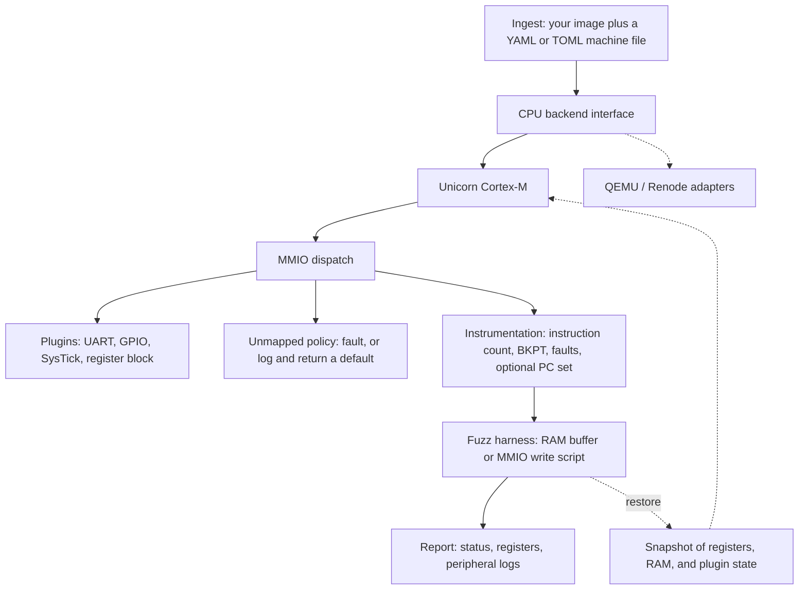

# rehost

rehost runs a firmware image you already have on a modeled microcontroller so you can trace it, snapshot it, and feed it fuzz input. The first CPU backend is [Unicorn](https://www.unicorn-engine.org/) emulating Cortex-M (Thumb and Thumb-2). Memory maps and peripherals come from a YAML or TOML file. QEMU and Renode can sit behind the same backend interface later; this tree does not implement them yet.

The tool does not download firmware. Tests and the built-in fixtures are synthetic programs assembled from source in this repository. Read [RESPONSIBLE_USE.md](RESPONSIBLE_USE.md) before you point it at a real image.

## Install

Python 3.11 or newer.

```bash
python3 -m pip install -e ".[dev]"
python3 -m pytest
python3 -m rehost run --fixture uart-gpio
```

`pip install -e .` is enough to run the CLI. The `[dev]` extra adds pytest.

A successful fixture run looks like this:

```text
name: uart-gpio
status: halted
detail: bkpt
pc: 0x00000042
sp: 0x20004000
lr: 0xffffffff
instructions: 20
uart0 tx: 41
gpioa odr: 0x1
systick ctrl: 0x0 load: 0x0 val: 0x0
```

Exit status is `0` for a halt (`BKPT` or a configured halt address), `1` for a fault, `2` for a timeout, `3` for the instruction limit, and `4` for a bad config or a missing file.

## Layout

```text
src/rehost/
  backends/         CpuBackend and the Unicorn Cortex-M adapter
  peripherals/      plugin registry plus UART, GPIO, SysTick, register block
  fixtures/         Thumb assembler and the synthetic programs
  config.py         YAML/TOML machine loader
  machine.py        map, load, boot, run, snapshot
  fuzz.py           RAM-buffer and MMIO-script sinks, AFL++ shared memory
  cli.py
examples/           copies of the fixture sources, for reading and editing
tests/
```

## Architecture



`Machine` is the object that ties these together. It asks the backend to map pages, execute, and read registers. It asks plugins what an MMIO load or store means. Snapshots are plain data (register names, region bytes, plugin dicts), so a future backend can restore them without Unicorn context objects.

## Run your own image

```bash
python3 -m rehost run --config examples/uart_gpio.yaml --firmware /path/to/image.bin
python3 -m rehost run --fixture uart-gpio -v
python3 -m rehost run --fixture fuzz-echo --input case.bin --snapshot-out after.json
python3 -m rehost plugins
python3 -m rehost fixtures
```

`--firmware` is a file you supply. `--config` is required with it, because the tool will not guess a memory map. `--fixture` selects one of the synthetic programs and, if you omit `--config`, its packaged machine file.

`--dump 0x20000000:16` prints a hex dump after the run. Repeat the flag for more windows.

## Machine file

`examples/uart_gpio.yaml` is a complete example. Addresses may be integers or `0x` strings. TOML works the same way (`python3 -m rehost run -c machine.toml --firmware image.bin`).

```yaml
name: uart-gpio
arch: cortex-m          # registered backend; only cortex-m today
endian: little

load:
  base: 0x00000000      # where --firmware is copied

memory:
  - name: flash
    base: 0x00000000
    size: 0x1000
    perms: rx           # r, w, x in any combination
  - name: sram
    base: 0x20000000
    size: 0x4000
    perms: rw           # writable regions are included in snapshots
  - name: uart0
    base: 0x40000000
    size: 0x100
    perms: rw
    peripheral: uart    # plugin name
    config:
      data_offset: 0x00
      status_offset: 0x04
      tx_empty_mask: 0x80
  - name: spare
    base: 0x40020000
    size: 0x100
    perms: rw
    mmio: true          # no model yet: log and return read_default
    read_default: 0

boot:
  mode: vector          # or entry, which needs sp and entry
  vector_base: 0x00000000

run:
  timeout_ms: 1000      # 0 means no time limit
  max_instructions: 1000000
  halt_on_bkpt: true
  halt_addresses: []    # stop before executing these PCs
  trace_limit: 256
  collect_coverage: false

unmapped:
  action: fault         # or log
  read_default: 0
  log: true
```

Regions must not overlap. The backend maps whole pages; two regions may share a page, and the page's permissions are the union. At least one of `timeout_ms` and `max_instructions` must be non-zero so a run cannot hang. `endian: big` is rejected.

`boot.mode: vector` reads the initial stack pointer and reset vector from `vector_base`, and sets the Thumb bit. `boot.mode: entry` starts at `entry` with `sp`.

### Plugins

| Name | Behavior |
| --- | --- |
| `uart` | A write to `data_offset` appends the low byte to `tx`. A read pops one byte from `rx` or returns 0. `status_offset` reports `tx_empty_mask` and, when `rx` is non-empty, `rx_ready_mask`. Other offsets are logged. |
| `gpio` | `odr_offset` is a latch. `idr_offset` returns `idr`, or the latch when `loopback: true`. |
| `systick` | CTRL / LOAD / VAL / CALIB at the Cortex-M offsets `0x00`, `0x04`, `0x08`, `0x0C`. While ENABLE is set, each read of VAL returns the current count and then decrements it. A read that sees 0 reloads from LOAD and sets COUNTFLAG. TICKINT records `irq_pending` on the plugin. The interrupt is not delivered. |
| `register_block` | `registers` maps a 4-byte-aligned offset to `{reset, writable}`. Unlisted offsets log and return `read_default`. |
| `unimplemented` | Every access is logged once at INFO and reads return `read_default`. `mmio: true` selects this plugin when `peripheral` is omitted. |

Unknown config keys are errors, so a typo does not silently do nothing.

## Add a peripheral

Put this in a module you import before you build the machine. Importing the module runs the decorator.

```python
from rehost.peripherals import Peripheral, register

@register("led_bank")
class LedBank(Peripheral):
    config_keys = frozenset({"read_default"})

    def __init__(self, **kwargs):
        super().__init__(**kwargs)
        self.last = 0

    def read(self, offset: int, size: int) -> int:
        return self.last & ((1 << (8 * size)) - 1)

    def write(self, offset: int, size: int, value: int) -> None:
        self.last = value & 0xFF

    def snapshot_state(self) -> dict:
        return {"last": self.last}

    def restore_state(self, state: dict) -> None:
        self.last = int(state["last"])
```

```yaml
- name: leds
  base: 0x40010000
  size: 0x100
  perms: rw
  peripheral: led_bank
```

`read` and `write` see offsets from the region base. Sizes are 1, 2, or 4. `snapshot_state` must return JSON-friendly values (`int`, `str`, `bool`, `list`, `dict`) or `bytes` (stored as hex in the snapshot file). The machine calls it for every fuzz iteration that uses `PersistentHarness`.

`python3 -m rehost plugins` lists whatever has been registered by the installed package. Your class appears after the process imports your module.

## Add a CPU backend

Subclass `CpuBackend`, implement the abstract methods, and register the `arch:` string. The methods `Machine` calls are `map_memory`, `protect_memory`, `read_memory`, `write_memory`, `read_register`, `write_register`, `read_registers`, `write_registers`, `start`, `stop`, the four hook installers, and `inject_irq`.

```python
from rehost.backends import CpuBackend, register_backend

@register_backend("qemu-cortex-m")
class QemuCortexM(CpuBackend):
    arch = "qemu-cortex-m"
    # map_memory, start, stop, hooks, ...
```

`arch: qemu-cortex-m`, `renode`, and `riscv` are recognized as planned names and fail with that explanation. They are not wired up.

`inject_irq` on the Unicorn backend appends to `backend.pending_irqs` and does not enter the NVIC. A backend that can deliver interrupts should override it.

## Snapshots

```python
from rehost import Machine

machine = Machine.from_fixture("uart-gpio")
machine.boot()
snap = machine.snapshot()
# mutate guest RAM or let a run complete, then:
machine.restore(snap)
snap.write_json("state.json")
```

The snapshot includes general-purpose registers, `sp`, `lr`, `pc`, `xpsr`, the Cortex-M banked stack and mask registers Unicorn exposes, every writable non-peripheral region, and each plugin's `snapshot_state`. Flash is not saved; reload the image, then restore. `Machine.restore` checks that the region set matches.

## Fuzz harness

The harness is the extension point for AFL++ or libAFL. It is not a fuzzer and it does not speak the AFL forkserver. You supply bytes; it places them, runs, and you look at `RunResult`.

`fuzz.mode: buffer` zeroes `buffer.max_size` bytes at `buffer.address`, copies the testcase (truncated to `max_size`), and optionally stores the length as a little-endian `u32` at `length_address`.

`fuzz.mode: mmio` treats the testcase as a script of 12-byte records: `u32` address, `u32` value, `u8` size (1, 2, or 4), three padding bytes. Each record becomes a plugin write.

```yaml
fuzz:
  mode: buffer
  buffer:
    address: 0x20000100
    max_size: 64
    length_address: 0x20000000
```

```python
from rehost import Machine, PersistentHarness

machine = Machine.from_fixture("fuzz-echo")
harness = PersistentHarness(machine)
for testcase in inputs:
    result = harness.exec_one(testcase)
    if result.faulted:
        result_path = "crash.json"
        machine.snapshot().write_json(result_path)
```

`exec_one` restores a checkpoint taken at boot, applies the testcase, and runs. Peripheral logs and RAM from the previous case are gone.

Input sources, in order:

1. `--input PATH`, or `--input -` for stdin
2. AFL++ shared memory when `__AFL_SHM_FUZZ_FD` or `__AFL_SHM_FUZZ_ID` is set. The map is the AFL++ layout: a little-endian `u32` length, then the testcase. `__AFL_SHM_FUZZ_MAP_SIZE` is the map size (default 1 MiB + 4).
3. `REHOST_INPUT_FILE`
4. stdin, when the machine file has a `fuzz:` section and stdin is not a terminal

`examples/fuzz_echo.s` loads the word at `0x20000100` and writes the low byte to the UART. `python3 -m rehost run --fixture fuzz-echo --input case.bin` is the command to try.

## Fixtures

| Name | Program |
| --- | --- |
| `uart-gpio` | Posts `A` to the UART, writes 1 to the GPIO latch, reads SysTick VAL, stores `0x00c0ffee` at `0x20000000`, then `BKPT`. |
| `fuzz-echo` | Loads the fuzz buffer at `0x20000100` and posts the low byte to the UART. |

Sources live in `src/rehost/fixtures/data/` and are copied under `examples/`. The assembler in `rehost.fixtures.assemble` encodes the few Thumb and Thumb-2 instructions these programs use, so CI does not need a cross toolchain. It is not a general assembler.

To study a real RTOS image, build it yourself (a Zephyr sample or a FreeRTOS demo you compile) and pass the raw binary with `--firmware` and a machine file you write for that part. Do not commit the image here.

## Design notes

- Unicorn treats an until-address of 0 as "stop at PC 0", which is the reset vector. The runner uses an until-address above 32 bits and stops from hooks instead.
- On Unicorn 2.1 the memory-read hook runs before the load retires. The dispatcher writes the plugin's value into guest memory inside that hook, and the instruction observes it.
- Unicorn's `uc_emu_start` timeout is microseconds. The machine file's `timeout_ms` is converted at the backend boundary. The Python binding's docstring that says milliseconds does not match Unicorn 2.1.
- A page is mapped writable so the image can be copied, then `run` applies the permissions from the config.
- SysTick advances when firmware reads VAL. It is a polling stub, not a cycle timer.

## Roadmap

Not in this version:

- RTOS and BSP shims for VxWorks, QNX, and ThreadX, including HAL-call replacement
- A RISC-V backend
- QEMU and Renode adapters on `CpuBackend`
- NVIC delivery for the IRQs `inject_irq` already queues
- Printer, ICS, and other device-specific peripheral models
- An AFL++ forkserver or a libAFL executor in-tree (the `exec_one` hook is the place those would call)
- A new CPU emulator. Decode and execute stay in Unicorn, or in QEMU/Renode when those adapters exist.

## License

MIT. See [LICENSE](LICENSE) and [RESPONSIBLE_USE.md](RESPONSIBLE_USE.md).
