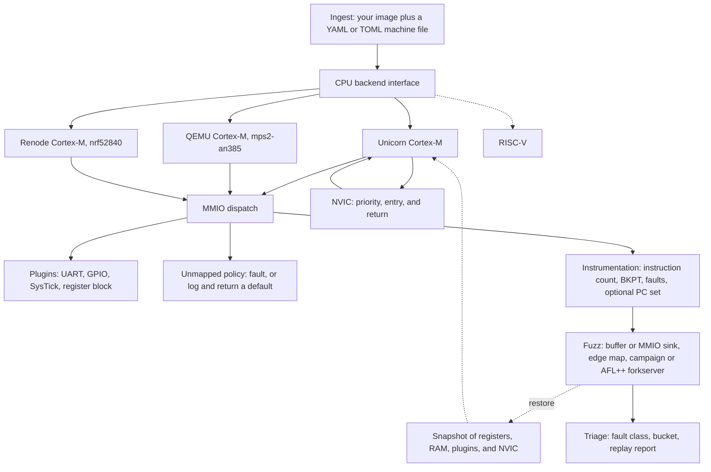

# Jig

Jig is a machine shop for plant-controller firmware: emulate it, instrument it, fuzz it, and triage what breaks. The command is `jig-emu`. The installable distribution name is `jigfw`. The import package is still `rehost` (`import rehost`, `python -m rehost`), so existing imports keep working. The default CPU backend is [Unicorn](https://www.unicorn-engine.org/) emulating Cortex-M (Thumb and Thumb-2). Memory maps and peripherals come from a YAML or TOML file. A second backend drives `qemu-system-arm` on the Cortex-M3 board QEMU already ships (`mps2-an385`); select it with `--backend qemu`. A third drives [Renode](https://renode.io/) on the Cortex-M4 platform Renode already ships (`@platforms/cpus/nrf52840.repl`); select it with `--backend renode`. RISC-V is not implemented.

The tool does not download firmware. Tests and the built-in fixtures are synthetic programs assembled from source in this repository. `--firmware` accepts a raw bin, a little-endian ARM ELF32, or Intel HEX. Two local smokes on published images are written up and are not in this tree, and CI does not run them: P2IM CNC (grbl 0.8c on STM32F407VG) through a Grbl session, and P2IM Console (RIOT on an NXP FRDM-K64F) through the shell banner and one `help`. See [P2IM CNC](#p2im-cnc) and [P2IM Console](#p2im-console). Read [RESPONSIBLE_USE.md](RESPONSIBLE_USE.md) before you point the tool at a real image.

## Install

Python 3.11 or newer.

```bash
python3 -m pip install -e ".[dev]"
python3 -m pytest
jig-emu run --fixture uart-gpio
```

`pip install -e .` is enough to run the CLI. The `[dev]` extra adds pytest.

A successful fixture run looks like this:

```text
name: uart-gpio
status: halted
detail: bkpt
pc: 0x00000042
sp: 0x20004000
lr: 0xffffffff
instructions: 20
uart0 tx: 41
gpioa odr: 0x1
systick ctrl: 0x0 load: 0x0 val: 0x0
```

Exit status is `0` for a halt (`BKPT` or a configured halt address), `1` for a fault, `2` for a timeout, `3` for the instruction limit, and `4` for a bad config or a missing file.

## Layout

```text
src/rehost/
  backends/         CpuBackend, plus the Unicorn, QEMU, and Renode Cortex-M adapters
  peripherals/      plugin registry plus UART, GPIO, SysTick, timer, register block, bit-band
  fixtures/         Thumb assembler and the synthetic programs
  modbus.py         Modbus RTU framing on the existing UART plugin
  serial.py         line-oriented UART RX injection
  config.py         YAML/TOML machine loader
  image.py          raw bin, ELF32, and Intel HEX loaders
  mapinit.py        starter machine YAML from an ELF or Intel HEX image
  machine.py        map, load, boot, run, snapshot
  fuzz.py           RAM-buffer, MMIO-script, and UART-RX sinks, AFL++ input map
  coverage.py       AFL++ edge bitmap
  campaign.py       in-process coverage-guided campaign
  forkserver.py     AFL++ persistent-mode forkserver
  triage.py         fault class, bucket id, crash report
  cli.py
examples/           fixture sources, the STM32F4 map, and the P2IM smoke maps
tests/
```

## Architecture



`Machine` is the object that ties these together. It asks the backend to map pages, execute, and read registers. It asks plugins what an MMIO load or store means. The Unicorn backend models the NVIC and exception entry in front of each instruction. The QEMU backend executes ordinary Thumb on `qemu-system-arm` and sends decoded plugin accesses through the same MMIO hooks; it does not take those NVIC exceptions. The Renode backend does the same kind of dispatch on `renode`'s monitor, on the `nrf52840` platform. `jig-emu fuzz` and the AFL++ forkserver stay on Unicorn. Snapshots are plain data (register names, region bytes, plugin dicts, and the NVIC image). A QEMU or Renode run's NVIC image is empty. See [QEMU Cortex-M](#qemu-cortex-m) and [Renode Cortex-M](#renode-cortex-m).

## Run your own image

```bash
jig-emu run --config examples/uart_gpio.yaml --firmware /path/to/image.bin
jig-emu run --config examples/cnc-p2im.yaml --firmware /path/to/CNC
jig-emu run --config examples/console-p2im.yaml --firmware /path/to/image.hex
jig-emu run --fixture uart-gpio -v
jig-emu run --backend qemu --fixture uart-gpio
jig-emu run --backend renode --fixture uart-gpio
jig-emu run --fixture fuzz-echo --input case.bin --snapshot-out after.json
jig-emu plugins
jig-emu fixtures
jig-emu inspect /path/to/image.elf
jig-emu map init /path/to/image.elf -o board.yaml
```

`--firmware` is a file you supply. `--config` is required with it, because the tool will not guess a memory map. `--fixture` selects one of the synthetic programs and, if you omit `--config`, its packaged machine file. The file may be a raw bin, an ELF, or Intel HEX. [Firmware image formats](#firmware-image-formats) is how each one is placed.

`--dump 0x20000000:16` prints a hex dump after the run. Repeat the flag for more windows.

## Firmware image formats

`--firmware` and `Machine.load_image` accept three layouts. The choice is the bytes, not the file name. A raw image whose first byte is `:` is still raw unless the first line is an Intel HEX record. A buffer that starts with the ELF magic is parsed as ELF even when the name ends in `.bin`.

- **Raw.** The file is copied to `load.base` as one span. This is the path `objcopy -O binary` produces. Passing `base=` to `load_image` places that span somewhere else. This path is unchanged.
- **ELF32.** A file that starts with the ELF magic is a little-endian ELF32 executable (`ET_EXEC` or `ET_DYN`) for `EM_ARM`. Each `PT_LOAD` segment with a non-zero file size is written at `p_paddr`, the load memory address. `p_vaddr` is where the firmware runs after its own copy loop, so a `.data` segment whose virtual address is SRAM is still stored at its physical address in flash. A toolchain that leaves `p_paddr` at 0 and stores the only address in `p_vaddr` is written at `p_vaddr`. Segments with a file size of 0 (BSS) are skipped; guest RAM starts zeroed. ELF64, big-endian ELF, a non-ARM machine, and a truncated header are errors. A segment that is not fully covered by the memory map is an error that names the segment, `p_paddr`, `p_vaddr`, and the address that missed.
- **Intel HEX.** A file whose first line is an Intel HEX record (`.hex`, `.ihex`, or any other name) is decoded, including extended linear address (type 04) and extended segment address (type 02). Each contiguous span is written at the address the records name. A checksum mismatch, a truncated record, a missing end-of-file record, or a span outside the map is an error. Start-address records (types 03 and 05) are checked and ignored. Boot still uses the vector table or `boot.entry`.

`load.base` applies only to a raw image. ELF and HEX already name their addresses, so `load_image(..., base=...)` is rejected for those two.

The published P2IM CNC file is an ELF with two loadable segments. `jig-emu run -f CNC` places both at `p_paddr`. You do not run `objcopy` first. See [P2IM CNC](#p2im-cnc).

## Start a map from an ELF

`jig-emu` will not guess a map for `--firmware`. `jig-emu inspect` and `jig-emu map init` read an ELF32 or Intel HEX image you already have and suggest one. They do not emulate it, and they do not download it. A raw bin has no addresses and is rejected.

```bash
jig-emu inspect firmware.elf
jig-emu map init firmware.elf -o board.yaml
jig-emu map init firmware.elf --aggressive -o board.yaml
jig-emu map init firmware.elf --name my-part -o board.yaml --force
```

`inspect` prints the program headers, the vector table at the lowest file-backed address (initial SP and reset), and the suggested regions. `map init` writes YAML. Omit `-o` to print that YAML on stdout. `--force` overwrites an existing file. `--name` overrides the machine name; the default is the file stem. `--aggressive` is the opt-in guess described below. `inspect --aggressive` prints the same guess.

What the file contains, and what it is not:

- **Flash** covers the file bytes. A `.data` image whose `p_vaddr` is SRAM is still counted in flash at `p_paddr`, which is where the reset copy loop reads it. The size is the next power of two. It is `rx`: a store to that window faults. Grow or shrink it to the part.
- **SRAM** covers the ELF's RAM segments. If the initial SP is the top of that RAM (including an odd `_estack` such as `0x2001FFFF`, which the CPU model word-aligns), the window ends there. If the SP sits inside the loaded RAM, the ELF does not say how big the part's SRAM is, and the window adds 64 KiB of slack. The comment says so.
- **SysTick** is the real plugin at `0xE000E010`. The rest of the system control block stays with the CPU backend. Do not map over `0xE000E000`.
- **`mmio_*` windows** are 1 KiB-aligned constants in `0x40000000..0x40100000` or `0x50000000..0x51000000`. Each is `unimplemented`: the access is logged once and the read returns 0. That is not a decoded peripheral. Thumb encodings can look like addresses; the alignment filter drops most of them, and a hit is still only a constant. If the image reads back a value it stored, delete `peripheral:` and the window is sticky RAM. If it spins on a ready bit, replace the offset with a `register_block` `follow` or `read_set`.
- **Bit-band.** When the suggested SRAM covers `0x20000000`, the file emits the SRAM alias at `0x22000000`. When a peripheral constant was found, it emits the peripheral alias at `0x42000000`. Both are the Cortex-M3/M4 windows. Delete them for an M0 or M0+.
- **`unmapped.action: log`** covers every other address. `-v` prints those accesses. A fetch of an unmapped address still faults.
- Boot is `vector` at the vector table address. The boot comment says the CPU model clears SP[1:0], so an odd `_estack` is left as it is. `timeout_ms` is 0 and `max_instructions` is 1000000. The instruction cap is what stops a loop. `halt_on_reset` is false: `SYSRESETREQ` reboots the core and the run continues.

`--aggressive` promotes constants it recognizes. The rules are guesses, and each promoted region says TODO:

- `0x40023800` (seen more often than a Kinetis MCG constant) becomes an STM32F2/F4/F7-shaped RCC `register_block`. Ready bits follow the enable bits, and SWS copies SW. `0x40023C00` becomes the flash interface: ACR reads back, and `FLASH_SR.BSY` stays 0.
- `0x40021000` is that same RCC guess only when `0x40023800` and the F4 GPIOA window `0x40020000` are both absent. On an F4 image it is GPIOE and stays `unimplemented`.
- `0x40064000` becomes a Kinetis MCG block with the FEI-to-PEE follow rules (CLKST, PLLST, LOCK0, IREFST, OSCINIT0).
- UART-like constants become `uart` stubs. STM32 status is `+0` and data is `+4`. Kinetis S1 is `+0x04` and D is `+0x07`. `rx_irq` is omitted. F4 USART1/USART6 are included only with the F4 RCC guess. F1 USART1 at `0x40013800` is included only with the F1 RCC guess, because that address is SYSCFG on F4.

The default file does not promote any of those. It names them in a TODO and leaves the window `unimplemented`.

The comments at the top of the YAML are the TODOs. After the file loads, run with `-v` and promote the offsets the image actually polls. [P2IM CNC](#p2im-cnc) and [P2IM Console](#p2im-console) are hand-written maps. `map init` is how you start another, and `--aggressive` is a head start, not a chip model.

A local check on 15 Nov 2026, against the published ELFs (not stored in this tree, and not run in CI):

- The default scaffold, 250000 instructions, still spins. CNC reads RCC `0x40023800` and the window returns 0, with no USART traffic. Console reads MCG `0x40064000` the same way. The new bit-band windows do not by themselves move a ready bit.
- `map init --aggressive` on the CNC ELF, 700000 instructions, prints the EEPROM fallback, the `$0` through `$23` settings, and `Grbl 0.8c ['$' for help]` on the guessed USART2 (891 bytes, the same startup text as the hand-written map). PC is `0x0800400c`, in the USART2 poll. There is still no TIM2, no GPIO, and no `rx_irq`. The hand-written map reaches that banner in fewer instructions.
- `map init --aggressive` on the Console ELF prints `main(): This is RIOT! (Version: 2018.04-vm-HEAD)` and a newline on the guessed UART0 (25000 instructions), then `bx r0` fetches the NMI slot at `0x8` and the run faults with an invalid instruction. It does not print `Welcome to RIOT!`. SIM, PORT, and the rest of the K64 are still `unimplemented`.

## Machine file

`examples/uart_gpio.yaml` is a complete example. Addresses may be integers or `0x` strings. TOML works the same way (`jig-emu run -c machine.toml --firmware image.bin`).

```yaml
name: uart-gpio
arch: cortex-m          # unicorn; qemu and renode are the other names
endian: little

load:
  base: 0x00000000      # where a raw image is copied; ELF and HEX carry addresses

memory:
  - name: flash
    base: 0x00000000
    size: 0x1000
    perms: rx           # r, w, x in any combination
  - name: sram
    base: 0x20000000
    size: 0x4000
    perms: rw           # writable regions are included in snapshots
  - name: uart0
    base: 0x40000000
    size: 0x100
    perms: rw
    peripheral: uart    # plugin name
    config:
      data_offset: 0x00
      status_offset: 0x04
      tx_empty_mask: 0x80
  - name: spare
    base: 0x40020000
    size: 0x100
    perms: rw
    mmio: true          # no model yet: log and return read_default
    read_default: 0

boot:
  mode: vector          # or entry, which needs sp and entry
  vector_base: 0x00000000

run:
  timeout_ms: 1000      # 0 means no time limit
  max_instructions: 1000000
  halt_on_bkpt: true
  halt_on_reset: false  # true stops on the first SYSRESETREQ or VECTRESET
  max_resets: 8         # silent reboot streak; 0 leaves only the other caps
  halt_addresses: []    # stop before executing these PCs
  trace_limit: 256
  collect_coverage: false

unmapped:
  action: fault         # or log
  read_default: 0
  log: true
```

Regions must not overlap. The backend maps whole pages; two regions may share a page, and the page's permissions are the union. At least one of `timeout_ms` and `max_instructions` must be non-zero so a run cannot hang. `endian: big` is rejected.

`boot.mode: vector` reads the initial stack pointer and reset vector from `vector_base`, and sets the Thumb bit. `boot.mode: entry` starts at `entry` with `sp`. Cortex-M ignores bits [1:0] of SP, MSP, and PSP (they read as zero). An odd word in the vector table, or a later `MSR` / `MOV` / `LDR` into SP, is word-aligned before the next instruction and before exception entry. A firmware image whose `_estack` is `0x2001FFFF` can take SysTick without a patched binary.

A word write to `AIRCR` (`0xE000ED0C`) with VECTKEY `0x05FA` and `SYSRESETREQ` (bit 2) or `VECTRESET` (bit 0) uses the same path as `boot(reset=True)`. SP and PC are loaded again from `vector_base`, or from `boot.sp` and `boot.entry`. CONTROL, PRIMASK, BASEPRI, and FAULTMASK are cleared, the NVIC returns to its reset state, and peripheral plugins return to the state captured at construction. SRAM is not reloaded. The UART `tx` buffer is kept, because it is the host's copy of bytes that already left the wire; the RX queue is not. The run then continues at the reset PC. `run.halt_on_reset: true` stops instead, with status `halted` and the request in the detail line. `run.max_resets` (default 8, `0` disables it) stops a streak of resets that transmitted no new UART byte, so a silent reboot loop cannot spend `max_instructions`. That stop is `halted`, not a fault, and the fuzzer does not treat it as a crash. A reboot that prints again clears the streak.

`run.svc_nop` is a list of SVC immediates (0 through 255) that retire as NOP instead of entering SVCall. Leave it empty unless the image uses an immediate as a harness hook. P2IM builds use `63` for `aflCall`. Other immediates still take the exception.

### Plugins

| Name | Behavior |
| --- | --- |
| `uart` | A write to `data_offset` appends the low byte to `tx`. A read pops one byte from `rx` or returns 0. `status_offset` reports `tx_empty_mask` and, when `rx` is non-empty, `rx_ready_mask`. Offsets are byte addresses, so a data register at `0x07` is valid. Other offsets are logged. Optional `rx_irq` (alias `irq`) latches that NVIC line when RX goes from empty to non-empty. The latch is one IRQ per burst unless `rx_level: true`, which pends again while bytes remain. Omit `rx_irq` and the line stays quiet. |
| `gpio` | `odr_offset` is a latch. `idr_offset` returns `idr`, or the latch when `loopback: true`. Optional `bsrr_offset` is an STM32-style bit set/reset: a 1 in the low half sets that `ODR` bit, a 1 in the high half clears it, and a bit set in both halves clears. |
| `systick` | CTRL / LOAD / VAL / CALIB at the Cortex-M offsets `0x00`, `0x04`, `0x08`, `0x0C`. While ENABLE is set, each instruction steps the counter once (CLKSOURCE does not select a second clock). A step that sees 0 reloads from LOAD, sets COUNTFLAG, and if TICKINT is set pends exception 15. Firmware that never reads VAL still gets that step; there is no `tick_every_n_instructions` divider. A direct read of VAL, used by the plugin unit tests, still returns the current count and then steps. `irq_pending` stays set after the first TICKINT edge; the NVIC pending bit is what delivery clears. |
| `timer` | While the enable bit is set, every `tick_every` instructions is one update event. The update flag is set, compare flags are set for compare registers that hold a non-zero value, and if an enabled flag is set the plugin pends `irq`. The next event waits until the guest clears those enabled flags, so a long handler cannot re-pend before it returns. ARR and the compare registers are latches. They do not pace the event. Defaults match STM32 general-purpose timer offsets. This is not a cycle-accurate timer. |
| `register_block` | `registers` maps a 4-byte-aligned offset to `{reset, writable, read_set, read_mask, read_bits, follow}`. Unlisted offsets log and return `read_default`. On read, `follow` copies bits from a stored value (`{src, dst, width}`, `width` defaults to 1) so a ready bit tracks an enable and clears when the enable clears. `from` names another register in the same block. `value` writes that constant into the destination when its source field is non-zero, and leaves the destination alone when the source is zero, so a later rule can override an earlier copy. Plain copies must not overlap. `read_set` is then ORed. `read_mask` / `read_bits` replace those bits last (`read_bits` must be a subset of `read_mask`). Unknown fields are errors. |
| `bitband` | Cortex-M bit-band alias. `config.target` is the first real address. A word at `base + byte*32 + bit*4` reads or writes that one bit of `target`. Bit 0 of the stored word is the bit. The target may be a plugin or RAM. |
| `unimplemented` | Every access is logged once at INFO and reads return `read_default`. `mmio: true` selects this plugin when `peripheral` is omitted. |

Unknown config keys are errors, so a typo does not silently do nothing.

## Add a peripheral

Put this in a module you import before you build the machine. Importing the module runs the decorator.

```python
from rehost.peripherals import Peripheral, register

@register("led_bank")
class LedBank(Peripheral):
    config_keys = frozenset({"read_default"})

    def __init__(self, **kwargs):
        super().__init__(**kwargs)
        self.last = 0

    def read(self, offset: int, size: int) -> int:
        return self.last & ((1 << (8 * size)) - 1)

    def write(self, offset: int, size: int, value: int) -> None:
        self.last = value & 0xFF

    def snapshot_state(self) -> dict:
        return {"last": self.last}

    def restore_state(self, state: dict) -> None:
        self.last = int(state["last"])
```

```yaml
- name: leds
  base: 0x40010000
  size: 0x100
  perms: rw
  peripheral: led_bank
```

`read` and `write` see offsets from the region base. Sizes are 1, 2, or 4. `snapshot_state` must return JSON-friendly values (`int`, `str`, `bool`, `list`, `dict`) or `bytes` (stored as hex in the snapshot file). The machine calls it for every fuzz iteration that uses `PersistentHarness`.

`jig-emu plugins` lists whatever has been registered by the installed package. Your class appears after the process imports your module.

## Add a CPU backend

Subclass `CpuBackend`, implement the abstract methods, and register the `arch:` string. The methods `Machine` calls are `map_memory`, `protect_memory`, `read_memory`, `write_memory`, `read_register`, `write_register`, `read_registers`, `write_registers`, `start`, `stop`, the four hook installers, and `inject_irq`.

```python
from rehost.backends import CpuBackend, register_backend

@register_backend("qemu-cortex-m")
class QemuCortexM(CpuBackend):
    arch = "qemu-cortex-m"
    # map_memory, start, stop, hooks, ...
```

`arch: qemu` and `arch: qemu-cortex-m` are the QEMU adapter. `arch: renode` and `arch: renode-cortex-m` are the Renode adapter. `riscv` is still a planned name and fails with that explanation.

`inject_irq(n)` pends external IRQ `n` (exception `16 + n`). On the Unicorn backend that bit enters the NVIC: the handler runs only when the IRQ is enabled, its group priority can preempt, and PRIMASK, FAULTMASK, and BASEPRI allow it. `backend.pending_irqs` is the list of external IRQs that are still pending. A UART `rx_irq` uses this same call; it does not install a second interrupt controller. On the QEMU and Renode backends `inject_irq` only records the number. The handler does not run.

## QEMU Cortex-M

```bash
jig-emu run --backend qemu --fixture uart-gpio
```

That command needs `qemu-system-arm` on `PATH` (or `JIG_QEMU` pointing at the binary). If it is missing, the process exits 4 and the error names `qemu-system-arm`. Unicorn stays the default: omit `--backend`, or pass `--backend unicorn`. `--backend` does not rewrite the machine file. A fixture file still says `arch: cortex-m`, and a snapshot taken this way still records that arch. `arch: qemu` or `arch: qemu-cortex-m` in the file selects the same adapter without the flag.

The machine is `mps2-an385`, the Cortex-M3 board image QEMU ships. Its SSRAM covers the synthetic flash and SRAM:

| Window | What QEMU maps |
| --- | --- |
| `0x00000000` for 8 MiB | SSRAM1 and its alias |
| `0x20000000` for 8 MiB | SSRAM2/3 and its alias |
| `0x21000000` for 16 MiB | PSRAM |

Code is fetched and executed by `qemu-system-arm`. Registers, RAM, and single-step use the gdbstub. QMP checks that `-S` held the CPU and quits the process. Pages outside those windows (the fixture UART at `0x40000000`, GPIO at `0x40001000`, SysTick at `0xE000E010`) are a host shadow, not the MPS2 SCC or the real system control block. Decoded loads and stores that touch a shadow page, a plugin hook, an unmapped address, or a permission the map does not allow are not issued to the board. They call the same memory hooks `Machine` installs for Unicorn, so the UART, GPIO, and SysTick plugins see the access.

On this tree, `jig-emu run --backend qemu --fixture uart-gpio` halts on `BKPT` at `pc 0x42` after 20 instructions, with `uart0 tx: 41` and `gpioa odr: 0x1`, the same outcome as Unicorn. The bytes left in SRAM (`0x00C0FFEE`, the SysTick read, the UART status) match too. Tests that spawn QEMU skip when `qemu-system-arm` is absent, so `python3 -m pytest` stays green without it.

Still Unicorn, and not this adapter:

- NVIC priority, exception entry and return, and delivery of `inject_irq`. The QEMU process has its own NVIC. Jig does not program it, and a pending IRQ is not taken. A SysTick plugin can still be read and written through the hooks. `TICKINT` does not enter a handler.
- The in-process fuzz campaign, the AFL++ forkserver, and the `--cmplog` stage. That stage logs compares on the Unicorn code hook. `jig-emu fuzz` has no `--backend` flag, so it does not run them on QEMU.
- `PUSH` / `POP` / `LDM` / `STM`, and Thumb-2 load/store forms this decoder does not parse, run inside QEMU when the base register points at board RAM. An undecoded load or store whose base is not board RAM is refused. It is not handed to an MPS2 device.
- Fetches have to land in the RAM windows above. A map whose code lives somewhere else cannot run on this machine.
- `WFI` and `WFE` retire without waiting. QEMU's gdb single-step blocks in `WFI`.
- Guest permission checks apply to fetches and to decoded data accesses. The board SSRAM itself is readable, writable, and executable, so an undecoded store can ignore an RX region.
- Banked registers are written by executing `msr`, because QEMU 8.2's gdbstub reads MSP, PSP, CONTROL, PRIMASK, BASEPRI, and FAULTMASK but does not apply `P` writes. The four bytes at `0x21FFFF00` (the top of PSRAM) are saved and restored around that instruction.
- Any RISC-V backend. Renode is a separate adapter. See [Renode Cortex-M](#renode-cortex-m).

This is not a full rehost. It does not download firmware, and it does not run the published P2IM images.

## Renode Cortex-M

```bash
jig-emu run --backend renode --fixture uart-gpio
```

That command needs the `renode` binary on `PATH` (or `JIG_RENODE` pointing at it). If it is missing, the process exits 4 and the error names `renode` and the release page. Install Renode from <https://github.com/renode/renode/releases> and put that binary on `PATH`. Unicorn stays the default: omit `--backend`, or pass `--backend unicorn`. `--backend` does not rewrite the machine file. A fixture file still says `arch: cortex-m`, and a snapshot taken this way still records that arch. `arch: renode` or `arch: renode-cortex-m` in the file selects the same adapter without the flag.

The platform is `@platforms/cpus/nrf52840.repl`, the Cortex-M4 description Renode ships. Jig loads it through the monitor socket (`renode --disable-gui --plain -P`) and does not add a robotframework or pyrenode dependency. On Renode 1.17 that file's RAM is:

| Window | What Renode maps |
| --- | --- |
| `0x00000000` for 1 MiB | `sysbus.flash` |
| `0x20000000` for 256 KiB | `sysbus.ram` |
| `0x00800000` for 256 KiB | the same `sysbus.ram`, aliased |

The adapter reads `GetRegistrationPoints` for those two peripherals after the platform loads, so a later Renode that resizes them is picked up. A YAML flash or SRAM region that misses both windows is a `Memory.MappedMemory` added with `LoadPlatformDescriptionFromString` when the address is free. Code can run there. An address the platform already decoded stays a host shadow: the fixture UART at `0x40000000` is the nRF clock, the fixture GPIO at `0x40001000` is the nRF radio, and SysTick at `0xE000E010` sits in the NVIC page.

Ordinary Thumb is one `cpu Step`. Registers are the monitor properties (`PC`, `SP`, `CPSR`, `PRIMASK`, and the rest). Decoded loads and stores that touch a shadow page, a plugin hook, an unmapped address, or a permission the map does not allow are not issued to the board. They call the same memory hooks `Machine` installs for Unicorn, so the UART, GPIO, and SysTick plugins see the access. The load/store decoder is the one the QEMU adapter uses.

On this tree, `jig-emu run --backend renode --fixture uart-gpio` halts on `BKPT` at `pc 0x42` after 20 instructions, with `uart0 tx: 41` and `gpioa odr: 0x1`, the same outcome as Unicorn. The bytes left in SRAM match too. Tests that spawn Renode skip when `renode` is absent, so `python3 -m pytest` stays green without it.

Still Unicorn, and not this adapter:

- NVIC priority, exception entry and return, and delivery of `inject_irq`. Renode has its own NVIC on this platform. Jig does not program it, and a pending IRQ is not taken. A SysTick plugin can still be read and written through the hooks. `TICKINT` does not enter a handler. `cpu VecBase` is written from `boot.vector_base`, and that does not by itself vector.
- The in-process fuzz campaign, the AFL++ forkserver, and the `--cmplog` stage. `jig-emu fuzz` has no `--backend` flag, so it does not run them on Renode.
- `PUSH` / `POP` / `LDM` / `STM`, and Thumb-2 load/store forms this decoder does not parse, run inside Renode when the base register points at platform RAM. An undecoded load or store whose base is not that RAM is refused. It is not handed to an nRF peripheral.
- `BKPT` and `SVC` are not stepped. Stepping them makes Renode enter its own NVIC. The interrupt hook sees them, and `halt_on_bkpt` still stops on `BKPT`.
- `WFI` and `WFE` advance PC without a step. `cpu Step` of `WFI` sleeps the core, and later steps stop retiring instructions.
- Guest permission checks apply to fetches and to decoded data accesses. Platform `MappedMemory` is readable, writable, and executable, so an undecoded store can ignore an RX region.
- MSP and PSP are the monitor's `SP` and `OtherSP`. On Renode 1.17, `IsUsingProcessSP` stayed clear after a `CONTROL` write, so those two properties are the stored banks. Exception entry, which is what would switch stacks on a chip, is not taken here.
- A fetch has to land in platform RAM or in a free window Renode accepted as `MappedMemory`. A region that overlaps a device Renode already mapped is a shadow, and the CPU cannot fetch it.
- RISC-V is still not implemented.

This is not a full rehost. It does not download firmware, and it does not run the published P2IM images.

## Snapshots

```python
from rehost import Machine

machine = Machine.from_fixture("uart-gpio")
machine.boot()
snap = machine.snapshot()
# mutate guest RAM or let a run complete, then:
machine.restore(snap)
snap.write_json("state.json")
```

The snapshot includes general-purpose registers, `sp`, `lr`, `pc`, `xpsr`, the Cortex-M banked stack and mask registers Unicorn exposes, every writable non-peripheral region, each plugin's `snapshot_state`, and the NVIC/SCB image (`cpu` in the JSON: enable, pending, active, priority, VTOR, priority grouping). Flash is not saved; reload the image, then restore. `Machine.restore` checks that the region set matches. A checkpoint taken for fuzzing therefore restores interrupt state with the RAM and the plugins.

## Fuzzing

`jig-emu fuzz` is a coverage-guided fuzzer. It calls `PersistentHarness.exec_one`, so every case starts from the same boot checkpoint (CPU, RAM, plugins, and NVIC). Two drivers share that hook, the edge map, and the crash rule:

* **In-process campaign**, used when you run `jig-emu fuzz` yourself. No AFL++ install is required. This is the driver to use for the planted-crash demo.
* **AFL++ persistent-mode forkserver**, used when `afl-fuzz` has attached the control pipes. The same process then stops between cases and lets afl-fuzz mutate.

libAFL is not a dependency. Its Python bindings (`pylibafl`) are a PyO3 extension over `libafl_sugar` and QEMU mode; they cannot host an existing Unicorn `Machine`, and they would add a Rust toolchain to this package. The campaign is the in-process shape (call the harness, observe a map, keep crashes) implemented in Python so one person can maintain it. The bitmap and the forkserver handshake follow AFL++.

### Run the planted crash

`fuzz-crash` is a synthetic Thumb program. It compares the first four bytes of the fuzz buffer with `JIG!`. Those bytes fetch an unmapped address and fault. Any other input executes `BKPT`. From a four-byte zero seed the deterministic stage matches one byte at a time, because each matched byte is a new edge, and that new input is extended before the rest of the parent input is finished.

```bash
jig-emu fuzz --fixture fuzz-crash --out ./fuzz-out --max-execs 3000 --stop-on-crash
```

A successful run prints `crashes: 1` and `buckets: 1`, writes the bytes `JIG!` under `fuzz-out/crashes/`, and writes one report under `fuzz-out/reports/`. The exit status of `jig-emu fuzz` is 0 when the campaign finishes; the crash count is in the summary and in that directory. `queue/` holds inputs that grew the edge map. `hangs/` holds stops the campaign classified as hangs. For a buffer or MMIO sink that is a guest timeout or the instruction cap. For a UART sink the cap is a finished command loop unless `hang_on_limit` is set, and only the wall-clock timeout is a hang. The summary also prints `edges`, `execs/sec`, and `seconds`. The report names the fault and gives the command that replays that one input. See [Crash triage](#crash-triage).

```text
jig-emu fuzz --fixture fuzz-crash --out DIR [options]
jig-emu fuzz --config machine.yaml --firmware image.bin --out DIR --seeds DIR
```

| Flag | Meaning |
| --- | --- |
| `--out DIR` | Corpus, crashes, and hangs. Required for the in-process campaign. |
| `--seeds DIR` | Seed files, in sorted name order. The default buffer seed is four zero bytes (or shorter, if the buffer is). A UART sink with no seeds starts from one newline. |
| `--input FILE` | One extra seed. `-` reads stdin. |
| `--max-execs N` | Stop after N executions. Default 1000000. |
| `--stop-on-crash` | Return after the first crash. The input is still written to `--out`. |
| `--rng-seed N` | Havoc RNG. The summary prints the seed that was used. |
| `--persistent-iters N` | Under afl-fuzz, restart the child after N cases. Default 10000. |
| `--cmplog` | In-process comparison stage. Off by default. See [Comparison logging](#comparison-logging). Ignored when an AFL++ forkserver is attached. |
| `--timeout-ms`, `--max-instructions` | Override the machine file for every case. |

The schedule is a deterministic walk of each byte on corpus items up to 16 bytes, then stacked havoc (bit flips, random and interesting bytes, arithmetic, insert, delete, splice, short overwrites). Fixed energy, one process. New coverage means an edge moved into a higher AFL hit-count class. `--cmplog` adds one more stage, described next. It does not run unless you pass the flag.

### Comparison logging

`--cmplog` is a CmpLog / RedQueen-style stage for the in-process campaign. A new corpus input is executed once more as a shadow run. That run counts toward `--max-execs`. The Unicorn code hook that already updates the edge map decodes the instruction about to retire and, for a compare it recognizes, records the two concrete operands. If either operand's bytes occur in the current input, the stage builds candidates that write the other operand over that span, then the byte-swapped encoding, then the value plus or minus one. Candidates go through the same `exec_one` path as any other mutation. A candidate that grows the edge map is logged in turn, so a second compare behind the first one can be solved after the first one is.

The patterns are Thumb and Thumb-2 `CMP` and `CMN`, flag-setting `SUB` (`SUBS`), and a 1, 2, or 4 byte load immediately followed by one of those compares. A load's width is kept, which is what a `ldrb` / `ldr` plus `cmp` magic-byte check needs. A shifted Thumb-2 register operand is logged as the value after a simple LSL, LSR, ASR, or ROR.

This is not symbolic execution. The stage only sees operands this concrete input actually compared. A check the shadow run did not reach is invisible. It does not solve a hash, a CRC, or any transform other than an endian swap and plus or minus one. Exact little-endian writes are tried before the swapped bytes and the off-by-one values. It does not colorize bytes the way RedQueen's taint pass does: it searches for the operand's bytes, so a value that is only computed and never present in the input is not written back. One shadow run keeps at most 64 unique pairs and builds at most 64 candidates, with at most 8 hit sites for a single pattern. `TST`, `TEQ`, `RRX`, and a shift of 32 are not logged. An operand in `PC` is not logged. A hit is a raw byte span, so on an MMIO script it can split a 12-byte record; that candidate is rejected. The AFL++ forkserver does not advertise a CmpLog map; under afl-fuzz the flag is ignored and afl-fuzz keeps mutating. The `fuzz-crash` demo does not need this stage: each matched byte is already a new edge, and the byte walk finds it.

The stage is off by default. A campaign that does not pass `--cmplog` does not attach a logger and does not decode compares.

### What coverage is

Unicorn already calls a Python hook for every instruction. When a coverage map is attached, each *retired* instruction (not one skipped because an exception was taken instead) updates a 65536-byte hit-count map:

```text
cur   = ((pc >> 1) ^ (pc >> 17)) & 65535
index = cur ^ prev
prev  = cur >> 1
map[index] += 1          # saturated at 255
```

That is AFL's edge update. AFL QEMU mode hashes a translation-block address; this hashes the instruction address, because that is the hook Unicorn already provides, and because the instruction after a compare has to stay visible or a magic-byte ladder looks like one path. `run.collect_coverage: true` is a separate, optional set of PCs for the text report. The fuzzer does not need it.

`Machine.run` zeroes the map and `prev` at the start of every execution, then sets byte 0 to 1 (AFL's "this iteration ran" marker). The map is not stored in the snapshot. Restoring the boot checkpoint therefore cannot put the previous case's hits back, and it cannot leak them forward either. The campaign keeps its own classified maximum across cases.

### AFL++

The forkserver implements AFL++'s version-1 handshake (`0x41464c00 + 1`, map size, shared-memory fuzzing when the fuzz region is present) and the persistent loop: the child raises `SIGSTOP` between cases, and a crash is `SIGSEGV` so `waitpid` reports `WIFSIGNALED`. `FS_NEW_OPT_FUTEX` is not offered; current AFL++ still accepts this `SIGSTOP` path. A guest fault and a PC listed in `fuzz.crash_addresses` are both crashes. A timeout or an instruction limit is not: afl-fuzz has its own `-t` timeout, and a `BKPT` is a normal exit unless that PC is configured as a crash.

The forkserver process does not create a Unicorn engine. The child does, after `fork`, and checkpoints before the first case. A banner checkpoint runs inside that child, so the first `-t` has to cover warmup plus one command. Later cases restore the snapshot. `AFL_FORKSRV_INIT_TMOUT` is the handshake, not that warmup.

```bash
mkdir -p seeds
printf '\0\0\0\0' > seeds/zero
AFL_PERSISTENT=1 afl-fuzz -i seeds -o afl-out -t 2000 -- \
  jig-emu fuzz --fixture fuzz-crash --out ./jig-out
```

`AFL_PERSISTENT=1` is read by afl-fuzz (the target file is a Python entry point, so afl-fuzz will not see the compiled-in `##SIG_AFL_PERSISTENT##` marker). Leave `AFL_MAP_SIZE` unset, or set it to at least 65536. Do not set `AFL_NO_FORKSRV`.

| Variable | Meaning |
| --- | --- |
| `__AFL_SHM_ID`, `__AFL_SHM_FD` | Coverage map. The fd is used when both are set. Only the first 65536 bytes are written. |
| `AFL_MAP_SIZE` | afl-fuzz's map. Must be at least 65536. |
| `__AFL_SHM_FUZZ_ID`, `__AFL_SHM_FUZZ_FD` | Testcase region: little-endian `u32` length, then the bytes. |
| `__AFL_SHM_FUZZ_MAP_SIZE` | Size of that region. Default 1 MiB + 4. |
| `AFL_FORKSRV_FD` | Optional. Control pipe fd; status is the next fd. afl-fuzz itself always uses 198 and does not set this. |
| `AFL_PERSISTENT` | Set in the environment of `afl-fuzz`, not required for the status word. |

Without the fuzz shared memory, pass `--input @@` and the child re-reads that file every iteration. With the fuzz region (what current afl-fuzz sets up), `--input` is not the per-case source.

Not in this fuzzer: IJON, the bug-pass map, dictionaries, parallel campaigns, and a corpus-minimization UI. `--cmplog` is the in-process comparison stage above. It is not AFL++ CmpLog shared memory, and it is not symbolic execution.

### Harness

You can still drive one case yourself. `fuzz.mode: buffer` zeroes `buffer.max_size` bytes at `buffer.address`, copies the testcase (truncated to `max_size`), and optionally stores the length as a little-endian `u32` at `length_address`.

`fuzz.mode: mmio` treats the testcase as a script of 12-byte records: `u32` address, `u32` value, `u8` size (1, 2, or 4), three padding bytes. Each record becomes a plugin write. The campaign trims a mutated script to a whole number of records.

`fuzz.mode: uart` replaces the named UART's RX queue with the testcase (truncated to `fuzz.uart.max_size`). Omit `fuzz.uart.name` when the machine has one UART. This is the input surface for a shell or a Grbl parser. `jig-emu run --input` queues those bytes before boot. `jig-emu fuzz` does not: with `fuzz.checkpoint.mode: banner` it boots, runs until that UART has transmitted and then gone quiet, snapshots, and applies each case to the snapshot. `fuzz.checkpoint.contains` is optional ASCII that must already be in TX before a quiet gap counts, so a pause in the middle of the banner is not the checkpoint. `fuzz.checkpoint.max_instructions` is the warmup cap. If the marker never shows up, the campaign stops with an error instead of fuzzing a half-booted image.

`fuzz.exec.max_instructions` and `fuzz.exec.timeout_ms` override `run.*` for each case and are restored afterward. `fuzz.exec.idle_instructions` (UART only) ends the case once RX is empty and TX has been quiet for that many instructions. A reply resets the quiet count while it is still printing. A partial line that the guest has already taken, and a command that does not answer, end on that gap instead of the instruction cap. A guest that never drains RX still runs to the cap. The status of that early stop is `halted`, and the detail names the UART. It is not a crash.

`fuzz.hang_on_limit` defaults to true for `buffer` and `mmio`, and false for `uart`. A true value means the instruction cap is a hang and does not join the corpus. A false value means the cap is a normal end: the edges still count. A wall-clock timeout is always a hang. afl-fuzz does not read this flag; its `-t` is the hang detector, and the forkserver reports a crash only for a fault or a `fuzz.crash_addresses` PC.

`fuzz.crash_addresses` is a list of PCs. A halt there is a crash even though the status is `halted`. The low bit is ignored. A fault is always a crash.

```yaml
fuzz:
  mode: buffer
  buffer:
    address: 0x20000100
    max_size: 64
    length_address: 0x20000000
```

```python
from rehost import Machine, PersistentHarness

machine = Machine.from_fixture("fuzz-echo")
harness = PersistentHarness(machine)
for testcase in inputs:
    result = harness.exec_one(testcase)
    if result.faulted:
        result_path = "crash.json"
        machine.snapshot().write_json(result_path)
```

`exec_one` restores the checkpoint, applies the testcase, and runs. The checkpoint is boot, unless the machine file asks for the banner. Peripheral logs, RAM, UART RX/TX (including the RX IRQ latch), SysTick, and NVIC pending bits from the previous case are gone. `PersistentHarness.reset_to_checkpoint` is that restore without applying a testcase. Queue a Modbus frame after it; bytes queued before the restore are dropped with the previous case. A recorded UART campaign against the published P2IM images is in [P2IM CNC](#p2im-cnc) and [P2IM Console](#p2im-console). CI does not run it.

Input sources, in order:

1. `--input PATH`, or `--input -` for stdin
2. AFL++ shared memory when `__AFL_SHM_FUZZ_FD` or `__AFL_SHM_FUZZ_ID` is set. The map is the AFL++ layout: a little-endian `u32` length, then the testcase. `__AFL_SHM_FUZZ_MAP_SIZE` is the map size (default 1 MiB + 4).
3. `REHOST_INPUT_FILE`
4. stdin, when the machine file has a `fuzz:` section and stdin is not a terminal

`examples/fuzz_echo.s` loads the word at `0x20000100` and writes the low byte to the UART. `jig-emu run --fixture fuzz-echo --input case.bin` is the command to try.

## Crash triage

A crash used to be a file under `--out/crashes` and, under afl-fuzz, a `SIGSEGV`. `jig-emu fuzz` now classifies the live stop, hashes it into a bucket, and writes one report per bucket. A second input that hits the same bug increments `seen` instead of writing another report. The representative file is the shortest input; equal lengths keep the earliest.

```text
out/crashes/<afl-name>                         every saved crashing input, up to 64
out/buckets/<id>/representative               shortest input for that bucket
out/buckets/index.json                         bucket id, class, seen, paths
out/reports/<id>.md                            the note you read
out/reports/<id>.json                          the same fields, for tooling
```

The forkserver writes the same reports before it raises `SIGSEGV`. `jig-emu triage` deletes `buckets/` and `reports/` and rebuilds them from the files currently in `crashes/`, in sorted name order. Seen counts then match those files. A campaign that is still running keeps a seen count for every crashing execution, including crashes past the 64-file cap; the representative for a new bucket is still stored under `buckets/` when the `crashes/` copy is skipped.

```bash
jig-emu fuzz --fixture fuzz-crash --out ./fuzz-out --max-execs 3000 --stop-on-crash
jig-emu triage --fixture fuzz-crash --out ./fuzz-out
jig-emu run --fixture fuzz-crash --input ./fuzz-out/buckets/<id>/representative
```

The replay line is the `jig-emu run` command in the report. It repeats the flags that selected the machine (`--fixture`, or `--config` and `--firmware`, plus `--timeout-ms` and `--max-instructions` when you overrode them) and `--input` pointed at the representative. The report's path is absolute, so the command does not depend on the current directory.

### Fault classes

The class comes from the detail string `Machine.run` already records, plus the registers and the memory map. Unicorn does not implement an MPU and does not update CFSR, HFSR, MMFAR, or BFAR. Permission faults are observed with Unicorn's protection hook, the same way unmapped accesses already were, so the faulting address is part of the detail line.

| Class | What the stop was |
| --- | --- |
| `null_deref` | The faulting fetch, read, or write address is below `0x100`. That is a null pointer or a small offset from one. A store through null into flash shows up here when flash is mapped read-only at address 0. |
| `unmapped_fetch` | Instruction fetch outside the machine map. Unicorn stops in the unmapped-fetch hook. On a chip this is the situation a BusFault handler would see, or HardFault when BusFault is disabled. IPSR is left unchanged. |
| `unmapped_read`, `unmapped_write` | Data access outside the machine map. Same hook, same limit: this is not entered as BusFault, and BFAR is not set. |
| `prot_fetch`, `prot_read`, `prot_write` | The address is mapped, and the machine file's permissions reject the access. This is the rehost map, not an MPU MemManage fault. A write below `0x100` is `null_deref` instead. |
| `stack_overflow` | Exception entry could not write the integer frame, SP still points into writable RAM, and the frame sits within 64 bytes below that region's base. That is a descending stack walking off the bottom of RAM. |
| `bad_sp` | The frame is not writable RAM, exception return could not unstack, or a saved detail line still names a misaligned stack pointer. The CPU model forces SP[1:0] to zero, so a current run does not stop only because the vector table pointer was odd. |
| `hardfault` | Lockup (the original exception and HardFault both could not be taken), a HardFault vector that is missing or not Thumb, or an exception return that failed an integrity check. The model stops. It does not nest another fault. |
| `memmanage` | The NVIC model was entering exception 4. Ordinary unmapped accesses are not this class. MMFSR is not implemented. |
| `bus_fault` | The NVIC model was entering exception 5. An unmapped access is classified above, because the hook stops the run before a BusFault is taken. |
| `usage_fault` | Unicorn rejected the instruction (`UC_ERR_INSN_INVALID`), stacked xPSR.T was clear on exception return (INVSTATE), or the model was entering exception 6. Unicorn does not enter UsageFault or HardFault for an undefined instruction. On a chip with UsageFault disabled, the reset default, that instruction escalates to HardFault. UFSR is not updated. |
| `bkpt` | The guest executed `BKPT`. With `halt_on_bkpt` the status is `halted`, and the fuzzer keeps it when the PC is in `fuzz.crash_addresses`. With `halt_on_bkpt` off, the detail is `exception 7`. That 7 is Unicorn's breakpoint vector, not an IPSR number. |
| `halt_crash` | The guest halted at a PC listed in `fuzz.crash_addresses`. The status stays `halted`. |
| `other` | Anything else, including a halt whose detail names `AIRCR.SYSRESETREQ` or `AIRCR.VECTRESET` (`halt_on_reset`, or the silent `max_resets` cap) and an Unicorn interrupt vector this classifier does not treat as a fault. The default reset path does not stop, so it is not classified. The detail line is the raw record. |

`exception 6` with no further text is Unicorn's interrupt hook, and it stays in `other`. `exception 6 vector ...` is the NVIC model entering UsageFault, and that is `usage_fault`.

### Bucket id

```text
bucket_id = sha256(material).hexdigest()[:16]
material  = fault_class|reason|fault_pc|lr_fp|preceding_pcs|handler_frame|edges
```

| Field | Encoding |
| --- | --- |
| `fault_class`, `reason` | The class and a short tag such as `fetch`, `lockup`, or `undef`. |
| `fault_pc` | Faulting PC, Thumb bit cleared, 8 lowercase hex digits. |
| `lr_fp` | `LR & ~1`, same encoding, when LR has the Thumb bit set, its top nibble is not `F` (so EXC_RETURN and the reset value `0xFFFFFFFF` are excluded), and the target falls in executable memory. Otherwise `-`. |
| `preceding_pcs` | The last 4 retired PCs, Thumb bit cleared, comma-separated. A trailing PC equal to `fault_pc` is dropped first. `-` when none remain. The machine keeps the last 8. |
| `handler_frame` | `stacked_pc,stacked_lr` when IPSR is non-zero, SP is aligned, and the 32-byte integer frame at SP can be read. Otherwise `-`. This is the frame the NVIC model stacked, not a walk of caller frames. |
| `edges` | The last 4 coverage-edge indexes, decimal, comma-separated, or `-`. |

The edge index is the same update as the AFL bitmap, for a 65536-byte map, recorded for every retired instruction whether or not a bitmap is attached:

```text
cur   = ((pc >> 1) ^ (pc >> 17)) & 65535
index = cur ^ prev
prev  = cur >> 1
```

The faulting data address is not in the hash. Two inputs that die at the same instruction with the same class, reason, and tail share a bucket even when the bad pointer differs. A null access is its own class, so it does not share a bucket with a wild pointer at the same instruction.

The `fuzz-crash` magic input `JIG!` is an unmapped fetch at `0x60000000`. The material line from that run is:

```text
unmapped_fetch|fetch|60000000|-|00000026,00000028,0000002c,00000030|-|26,29,28,19
```

and the bucket id is `e14172fe0db2ca7e`. A longer input with the same prefix takes the same path, so it lands in that bucket. The report's site and input sections include:

```text
# unmapped_fetch `e14172fe0db2ca7e`

Fault class: unmapped_fetch
Reason: fetch
Bucket: e14172fe0db2ca7e
Seen: 1
Machine: fuzz-crash
Status: fault

- pc: 0x60000000
- lr: 0xffffffff
- sp: 0x20001000
- xpsr: 0x61000000
- ipsr: 0
- detail: unmapped fetch at 0x60000000
- fault address: 0x60000000 (fetch)
- hex: 4a494721
- sha256: e592e1391c7b8db00b9105d5b07457243ab7f301c41b28758d8ceebc0884b5d6
```

`xPSR` is `0x61000000` here because the compares that matched `JIG!` left N and Z set, and the Thumb bit in EPSR is set. IPSR is still 0: the model did not enter a fault handler. The replay command printed in the report is:

```text
jig-emu run --fixture fuzz-crash --input <out>/buckets/e14172fe0db2ca7e/representative
```

Not in this triage: exploitability scoring, a symbolic root cause, Ghidra or any other decompiler, and a stack unwind past LR, the handler frame, and the retired-instruction tail.

## Fixtures

| Name | Program |
| --- | --- |
| `uart-gpio` | Posts `A` to the UART, writes 1 to the GPIO latch, reads SysTick VAL, stores `0x00c0ffee` at `0x20000000`, then `BKPT`. |
| `fuzz-echo` | Loads the fuzz buffer at `0x20000100` and posts the low byte to the UART. |
| `fuzz-crash` | `BKPT` unless the buffer starts with `JIG!`, which fetches unmapped memory and faults. |
| `modbus-rtu` | Enables UART IRQ 0, waits, and answers one Modbus RTU request. Read Holding Registers at address 0, quantity 1, returns holding register `0x1234`. Other reads and other function codes return an exception. See [Modbus RTU](#modbus-rtu). |
| `plant-floor` | STM32-shaped controller at `0x08000000`. Polls the RCC and FLASH stubs, takes one SysTick interrupt, answers the same Modbus read on USART2, and fetches unmapped memory if the fuzz buffer is `JIG!`. See [Plant-floor beachhead](#plant-floor-beachhead). |

Sources live in `src/rehost/fixtures/data/` and are copied under `examples/`. The assembler in `rehost.fixtures.assemble` encodes the few Thumb and Thumb-2 instructions these programs use, so CI does not need a cross toolchain. It is not a general assembler.

To study a real RTOS image, build it yourself and pass it with `--firmware` and a machine file you write for that part. A raw bin, an ELF, or Intel HEX all load. [Plant-floor beachhead](#plant-floor-beachhead) is the procedure, and `examples/stm32f4_clock.yaml` is the map to copy. [P2IM CNC](#p2im-cnc) and [P2IM Console](#p2im-console) are recorded boots of two published images. Keep the image on your machine.

## Design notes

- Unicorn treats an until-address of 0 as "stop at PC 0", which is the reset vector. The runner uses an until-address above 32 bits and stops from hooks instead.
- On Unicorn 2.1 the memory-read hook runs before the load retires. The dispatcher writes the plugin's value into guest memory inside that hook, and the instruction observes it.
- Unicorn's `uc_emu_start` timeout is microseconds. The machine file's `timeout_ms` is converted at the backend boundary. The Python binding's docstring that says milliseconds does not match Unicorn 2.1.
- A page is mapped writable so the image can be copied, then `run` applies the permissions from the config.
- While a `Machine` owns SysTick, the counter steps once per instruction fetched for execution while ENABLE is set. It is not a cycle-accurate clock, and it is not divided by an extra `tick_every_n_instructions` knob. `CLKSOURCE` is stored and does not select a separate reference. Firmware that never reads VAL still receives COUNTFLAG and, with TICKINT, exception 15.

## Interrupts

The Unicorn backend delivers ARMv7-M exceptions before each instruction. SysTick is exception 15. External IRQ `n` is exception `16 + n`. The vector address is `VTOR + exception * 4`, and bit 0 of that word must be set. `boot.mode: vector` initializes VTOR from `vector_base`.

On entry the model stacks `r0`, `r1`, `r2`, `r3`, `r12`, `lr`, the return PC, and `xPSR` on MSP or PSP (PSP only from Thread mode with `CONTROL.SPSEL`). Bits [1:0] of the stack pointer are forced clear first. `CCR.STKALIGN` (set at reset) then forces 8-byte alignment and records the adjustment in stacked `xPSR` bit 9. `lr` becomes `0xFFFFFFF1` (back to Handler mode on MSP), `0xFFFFFFF9` (Thread mode, MSP), or `0xFFFFFFFD` (Thread mode, PSP). The handler runs on MSP with IPSR set to the exception number. Return is recognized on `BX`/`BLX`, `MOV PC`, and 16-bit or Thumb-2 `POP`/`LDM` that load an `EXC_RETURN` value; the frame is unstacked and `FAULTMASK` is cleared except on the way out of NMI.

A pending exception runs when it is enabled, not already active, and its group priority is strictly more urgent than the execution priority. All eight priority bits are implemented. `AIRCR.PRIGROUP` splits group priority from subpriority. PRIMASK boosts execution priority to 0, FAULTMASK to -1, and BASEPRI masks on the group field (a zero group field disables BASEPRI). NMI is fixed at -2 and HardFault at -1. `inject_irq`, `ISPR`/`STIR`, and `ICSR` (`PENDSVSET`, `PENDSTSET`, `NMIPENDSET`) latch pending bits. Taking the exception clears the pending bit. `SVC` enters SVCall, or HardFault if the current priority or a mask blocks it.

`WFI` and `WFE` do not suspend the emulator. If an exception can be taken, the stacked return PC is the instruction after the hint. Otherwise the hint retires in one instruction, including when PRIMASK or BASEPRI is holding a pending interrupt off, so `timeout_ms` and `max_instructions` still stop a wait loop.

Not modeled: tail-chaining and late arrival (a new exception after a return is unstacked and stacked again), lazy floating-point frames (`EXC_RETURN` bit 4 clear stops the run), v8-M stack limits and security extensions, and `SLEEPONEXIT` / `SLEEPDEEP` (the bits are stored and do not change control). `AIRCR.SYSRESETREQ` and `VECTRESET` are modeled: see the boot paragraph above. A bad VECTKEY does not request a reset.

## Stack pointer, ready bits, and bit-band

Three behaviors that show up in STM32 HAL startup are part of the model, not of one board file.

**Stack pointer.** Writes to SP, MSP, and PSP clear bits [1:0]. The vector-table load does this, and so does a guest `MSR`, `MOV`, or `LDR` into SP: the bits are clear before the next instruction and before exception entry. `CCR.STKALIGN` still looks at bit 2 after that.

**IT blocks.** An asynchronous exception is not taken on the predicated instructions that follow an `IT`. The pending bit stays set and the exception is taken on the instruction after the block. Redirecting PC in the middle of an `IT` block does not stick on this backend.

**Ready bits.** A `register_block` cell may list `follow`. Each entry copies `width` bits from `src` onto `dst` at read time, using the value firmware stored. HSERDY can follow HSEON, including the wait for the bit to read 0 after a disable. A two-bit field is the same mechanism: `src: 0`, `dst: 2`, `width: 2` makes SWS a copy of SW. `read_set` still forces bits high when that is what you want. `read_mask` still wins last.

**Bit-band.** The architecture aliases each bit of a 1 MiB region to its own word. A `bitband` region declares the alias window and `target`:

```yaml
- name: peripheral_bitband
  base: 0x42000000
  size: 0x02000000
  perms: rw
  peripheral: bitband
  config:
    target: 0x40000000
```

A store of 1 at `0x42470060` sets bit 0 of byte `0x40023803`, which is `RCC_CR.PLLON` on an STM32F4. If that cell's `follow` maps bit 24 onto bit 25, the next read of `RCC_CR` has PLLRDY set. A store of 0 clears it. The same plugin covers the SRAM alias at `0x22000000` with `target: 0x20000000`. The alias windows are 32 MiB because each target bit is a word. They are not a copy of the peripheral; reads and writes touch the real byte.

`examples/stm32f4_clock.yaml` is a map that uses all three. It does not decode PLLCFGR or insert a lock delay. SWS changes on the read after SW is written. The published P2IM CNC image exercises this path through to the Grbl banner. See [P2IM CNC](#p2im-cnc).

## UART RX interrupt

Set `rx_irq` on a `uart` region to an external IRQ number (`0` .. `255`). `irq` is an alias; if both are set they must match. When the RX queue goes from empty to non-empty, the plugin calls `Machine.inject_irq`, which pends that line in the NVIC from Phase 1. The handler runs on a later instruction, once the guest has enabled the IRQ and the priority and mask rules allow it.

The latch is one-shot for a burst. A second byte queued while RX is still non-empty does not pend again. After the guest reads the queue empty, the next byte pends again. Reading the data register does not clear a pending bit that was already latched; taking the exception or writing `ICPR` does. Leave `rx_irq` out and preloaded `rx` bytes stay quiet, which is what `uart-gpio` does.

```yaml
- name: uart0
  base: 0x40000000
  size: 0x100
  perms: rw
  peripheral: uart
  config:
    data_offset: 0x00
    status_offset: 0x04
    tx_empty_mask: 0x80
    rx_ready_mask: 0x01
    rx_irq: 0
```

`examples/stm32f4_clock.yaml` places the same plugin at the STM32F405/407 USART2 address (`0x40004400`) with status at offset 0, data at offset 4, and `rx_irq: 38`. Status bit 7 (`TXE`) and bit 6 (`TC`) both read as set (`tx_empty_mask: 0xC0`), because the stub has no shift register, and bit 5 (`RXNE`) is set while RX is non-empty. That is still this byte UART. BRR and CR1 writes are logged and ignored.

## Modbus RTU

`rehost.modbus` frames RTU requests and checks the CRC on TX. It queues bytes with `Uart.queue_rx`. It does not replace the UART plugin, speak Modbus TCP, or implement EtherNet/IP, DNP3, or OPC-UA. Builders cover Read Holding Registers (`0x03`), Write Single Register (`0x06`), and an exception response (`function | 0x80`). The CRC is the Modbus CRC-16 (polynomial `0xA001`, init `0xFFFF`), low byte first. There is no 3.5-character gap and no multi-drop schedule.

```bash
jig-emu run --fixture modbus-rtu --modbus-read 1:0:1
jig-emu run --fixture modbus-rtu --modbus-write 1:0:3
```

`--modbus-read` is `SLAVE:ADDRESS:COUNT`. `--modbus-write` is `SLAVE:ADDRESS:VALUE`. They are mutually exclusive. `--modbus-uart NAME` picks the peripheral when the machine has more than one UART. The read above is slave 1, address 0, quantity 1. The fixture answers with holding register `0x1234`:

```text
name: modbus-rtu
status: halted
detail: bkpt
pc: 0x00000054
sp: 0x20001000
lr: 0xffffffff
instructions: 493
uart0 tx: 0103021234b533
uart0 rx_irq: 0
systick ctrl: 0x0 load: 0x0 val: 0x0
```

`0103021234b533` is slave 1, function `0x03`, two data bytes, value `0x1234`, CRC `0x33B5`. The write command is function `0x06`, which this fixture does not implement, so TX is the exception `01860183a0` (function `0x86`, code 1, illegal function). A read of any other address is exception code 2. A read of address 0 with a quantity other than 1 is exception code 3. The fixture consumes eight request bytes and does not check the request CRC; the response CRC is computed.

The same exchange from Python, with the boot checkpoint restored between cases:

```python
from rehost.fuzz import PersistentHarness
from rehost.machine import Machine
from rehost.modbus import read_holding_registers, read_holding_values, run_exchange

machine = Machine.from_fixture("modbus-rtu")
harness = PersistentHarness(machine)
result, frame = run_exchange(
    machine,
    read_holding_registers(1, 0, 1),
    harness=harness,
)
assert result.status == "halted"
assert read_holding_values(frame) == [0x1234]
```

`run_exchange` calls `reset_to_checkpoint` before `deliver`, so RX from the previous case is gone before the new frame is queued. The fixture has no `fuzz:` section, and `jig-emu run` therefore does not read stdin as a testcase. A harness in your own script can set `machine.config.fuzz` if you also want `exec_one`.

## Serial text

`rehost.serial` queues bytes on the same UART plugin. It is the line-oriented counterpart of `rehost.modbus.run_exchange`. There is no TTY. A string passed to `run_lines` is ASCII and gains a newline when it does not already end in `\n` or `\r`.

`jig-emu run` accepts the same idea as flags:

- `--serial-in TEXT` is repeatable. Escapes are `\n`, `\r`, `\t`, `\\`, and `\xHH`. With `--serial-idle`, each flag is its own chunk. Without it, the chunks are concatenated.
- `--serial-file PATH` appends one raw chunk.
- `--serial-uart NAME` selects the peripheral. The default is the only UART.
- `--serial-after N` queues once N instructions have retired. `0` queues before the first instruction.
- `--serial-idle N` waits until TX has been quiet for N instructions. The first chunk also waits until TX has grown, so a banner can finish. Later chunks wait until the guest has made progress on the previous one and TX is quiet again.
- `--serial-settle N` waits N extra instructions before the last chunk. Use it when the guest keeps working after it stops printing.

```python
from rehost.machine import Machine
from rehost.serial import run_lines

machine = Machine.from_path("machine.yaml")
machine.load_image(open("image.bin", "rb").read())
result, tx, _new = run_lines(machine, ["$$\n", "?\n"], uart="usart2", idle_instructions=8000)
```

The P2IM CNC section is a real image driven with these flags. The unit tests use a synthetic UART poll, not that image.

## Plant-floor beachhead

Phase 5's CI proof is a controller that boots, takes a tick, answers one serial request, and leaves a crash you can open. That image is assembled in this repo. A separate local smoke has also run the published P2IM CNC firmware to its Grbl banner on the same STM32F4 map. See [P2IM CNC](#p2im-cnc). A Zephyr or FreeRTOS binary you build stays on your machine. Read [RESPONSIBLE_USE.md](RESPONSIBLE_USE.md) before you point `--firmware` at one. This tree does not download or commit any of those images.

### Synthetic demo

`plant-floor` is the CI image. Flash is at `0x08000000`, which is where an STM32F4 boots when the boot pins select main flash. The program polls `RCC_CR` until `HSIRDY` is set, writes `FLASH_ACR`, reads `FLASH_SR` until it is zero, lights GPIOA `ODR` bit 0, and enables SysTick with `TICKINT`. The main loop waits until the word at `0x20000000` is non-zero. That store is the SysTick handler, which also sets GPIOA `ODR` bit 1. `LOAD` is `0xFFFF`, so the counter fires once (it starts at 0) and does not fire again during this program.

After that tick the reset path enables IRQ 38. A Modbus frame queued before the run is already pending, so the USART2 handler runs, writes the response, and returns. Control then falls into a maintenance window that reads the fuzz buffer at `0x20000100`. `JIG!` fetches unmapped `0x60000000`. Any other buffer executes `BKPT`. `--modbus-read` queues the RTU frame. The fuzzer feeds the maintenance window and leaves the UART idle.

```bash
jig-emu run --fixture plant-floor --modbus-read 1:0:1
jig-emu fuzz --fixture plant-floor --out ./fuzz-out --max-execs 4000 --stop-on-crash
jig-emu triage --fixture plant-floor --out ./fuzz-out
jig-emu run --fixture plant-floor --input ./fuzz-out/buckets/31fe281f1c29dd2b/representative
```

The fixture has a `fuzz:` section. In a terminal, `jig-emu run` does not read stdin. If stdin is a pipe, those bytes are the fuzz buffer. An empty pipe still answers the Modbus read. Pass `--input` when you want a specific buffer and a pipe at the same time.

A successful exchange:

```text
name: plant-floor
status: halted
detail: bkpt
pc: 0x08000164
sp: 0x20004000
lr: 0xffffffff
instructions: 537
usart2 tx: 0103021234b533
usart2 rx_irq: 38
gpioa odr: 0x3
systick ctrl: 0x7 load: 0xffff val: 0xfdfb
```

`0103021234b533` is the same slave-1 read of holding register `0x1234` as [Modbus RTU](#modbus-rtu). `odr: 0x3` is the run lamp plus the tick lamp. `ctrl: 0x7` is `ENABLE | TICKINT | CLKSOURCE`. The tick word at `0x20000000` is 1.

`jig-emu fuzz` writes the usual `crashes/`, `buckets/`, and `reports/` layout. From a four-byte zero seed the deterministic walk reaches `JIG!` and stops. The summary is `crashes: 1` and `buckets: 1`. `jig-emu triage` deletes `buckets/` and `reports/` and rebuilds them from `crashes/`. The bucket id in this tree is `31fe281f1c29dd2b`. The material line is:

```text
unmapped_fetch|fetch|60000000|-|08000158,0800015a,0800015e,08000162|-|1785,1787,1785,1766
```

The fault PC is the same unmapped address as `fuzz-crash`. The preceding PCs are the maintenance window in flash at `0x08000000`, so the bucket is not the `fuzz-crash` bucket. The replay line in the report is the `jig-emu run --input` command above, with the directory you passed to `--out`.

The machine file for this fixture is `examples/plant_floor.yaml` (the packaged copy is what `--fixture` loads). It is a smaller sibling of the template: same peripheral addresses, 4 KiB of flash, 16 KiB of SRAM, and `unmapped.action: fault` so a stray access fails the test. The template logs unmapped data accesses instead, which is what you want while you are still finding them.

### Machine file to copy

`examples/stm32f4_clock.yaml` is the STM32F405/407-class map. The name is historical; the file is the beachhead template, not only the clock stub. Copy it, resize the memories to your part, and pass it as `--config`. It does not contain a `fuzz:` section. Add one when you are ready to fuzz, aimed at a buffer the image already reads:

```yaml
fuzz:
  mode: buffer
  buffer:
    address: 0x20000100
    max_size: 64
```

`jig-emu fuzz` writes that buffer. It does not inject each testcase as UART RX. To fuzz the RTU parser, restore the boot checkpoint and call `rehost.modbus.deliver` yourself between cases. `run_exchange` does that restore before it queues the frame.

| Window | Address | What the stub returns |
| --- | --- | --- |
| Flash | `0x08000000` | 1 MiB, execute. The `0x0` alias is not mapped, so a null fetch still faults. |
| CCM | `0x10000000` | 64 KiB, read/write. |
| SRAM | `0x20000000` | 128 KiB. |
| Backup SRAM | `0x40024000` | 4 KiB, read/write. |
| GPIOA | `0x40020000` | `IDR` at `0x10`, `ODR` at `0x14`. `MODER`, `BSRR`, and `AFR` are logged and read as 0. GPIOB through GPIOI are `unimplemented` windows. |
| USART2 | `0x40004400` | Jig UART, RX IRQ 38. `TXE` and `TC` read as set. `RXNE` tracks the RX queue. |
| RCC | `0x40023800` | `CR` ready bits follow the ON bits (`HSIRDY`/`HSION`, `HSERDY`/`HSEON`, `PLLRDY`/`PLLON`, `PLLI2SRDY`/`PLLI2SON`). They clear when the enable clears. `CFGR.SWS` copies `SW`. `LSERDY` follows `LSEON` and `LSIRDY` follows `LSION`. There is no lock delay. |
| FLASH | `0x40023C00` | `ACR` is writable, so a latency write reads back. `SR` ignores writes and `BSY` (bit 16) reads as 0. |
| Peripheral bit-band | `0x42000000` | 32 MiB alias onto `0x40000000`. A word store sets or clears one bit. `0x42470060` is `RCC_CR.PLLON`. |
| SRAM bit-band | `0x22000000` | 32 MiB alias onto `0x20000000`. |
| SysTick | `0xE000E010` | The per-instruction counter above. |
| NVIC / SCB | `0xE000E000` | Not a region. The Cortex-M backend owns this page. Do not map a plugin over it. SysTick is the one plugin inside the page; the NVIC model does not claim those 16 bytes. |

USART1, USART3, UART4, UART5, USART6, TIM2, I2C1, SPI1, ADC, SYSCFG, EXTI, PWR, CRC, and DMA1/DMA2 are `unimplemented` 1 KiB windows: a read returns 0 and is logged once. A poll of a ready bit in one of those windows does not finish until you promote that offset to `register_block`. The file header lists the bases that are not mapped (other timers, CAN, DAC, Ethernet, USB) so you can paste a window when the trace names it.

Unlisted RCC or FLASH offsets log and return 0. `unmapped.action` is `log`, so an address the file does not mention returns 0 instead of faulting. A fetch of an unmapped address still faults. A typo in a register field (`ready:` instead of `follow:`) is still a config error. SWS follows SW with no lock wait. This is not a model of the RCC state machine, and it is not a GPIO or USART HAL. The `plant-floor` fixture keeps the older stuck-ready `read_set` cells; the synthetic program only waits for bits that are already 1.

The same keys load from TOML.

### Widen the map from a trace

1. Run `jig-emu run -v --config examples/stm32f4_clock.yaml --firmware /path/to/image.elf` (or `.hex`, `.ihex`, or a raw `.bin`). A raw image is copied to `load.base` and its first word is the initial stack pointer. An ELF32 is placed by `PT_LOAD` `p_paddr`. Intel HEX is placed by the record addresses. You do not have to run `objcopy` first. A raw bin from `arm-none-eabi-objcopy -O binary` still works.
2. `unhandled MMIO` names an offset inside a window the file already lists. `unmapped read` or `unmapped write` names an address to add. An instruction limit with the PC sitting in a compare/branch is a poll of a bit that still reads as 0.
3. For that bit, add a `register_block` cell. `follow` copies an enable bit onto a ready bit and clears it when the enable clears. `read_set` ORs bits on every read. `read_mask` and `read_bits` force a field. `writable: false` ignores stores. Copy `RCC_CR` and `FLASH_SR` in the template. A bit-band store shows up as an access in `0x42000000`–`0x43FFFFFF` or `0x22000000`–`0x23FFFFFF`; those windows are already in the template.
4. Leave a peripheral you have not read yet as `unimplemented`. Promote the offsets the image actually spins on. Do not transcribe RM0090 into a HAL.
5. In Ghidra, import the raw bin as ARM Cortex little-endian at `0x08000000`. Constants in `0x40000000`–`0x5FFFFFFF` and `0xE0000000`–`0xE00FFFFF` are the MMIO sites. Cross-check them against RM0090. The vector table in the startup file is where `rx_irq` comes from: USART1 is 37, USART2 is 38, USART3 is 39, UART4 is 52, UART5 is 53, USART6 is 71 on the F405/407.

### Build the image yourself

These commands run on your machine. They are not part of CI, and nothing in this repository executes them.

Zephyr's Modbus RTU server sample is `samples/subsys/modbus/rtu_server`. Zephyr's own docs exercise it on boards that are not STM32. For an STM32F4-class part, `nucleo_f429zi` is a maintained Cortex-M4 board (STM32F429ZI). Confirm the identifier with `west boards`; hardware-model v2 trees may want `nucleo_f429zi/stm32f429xx`.

```bash
west build -b nucleo_f429zi samples/subsys/modbus/rtu_server -- \
  -DCONFIG_BUILD_OUTPUT_BIN=y \
  -DCONFIG_ARM_MPU=n \
  -DCONFIG_HW_STACK_PROTECTION=n
```

The image is `build/zephyr/zephyr.bin`. This model has no MPU. The board defconfig turns the MPU on, and hardware stack protection uses it, so the two `CONFIG_` lines above keep early init from programming an MPU this backend will not enforce.

That part is not the F405/407 the template sizes. Give it 2 MiB of flash (`size: 0x200000`) and 192 KiB of system SRAM at `0x20000000`. CCM stays 64 KiB at `0x10000000`. On this board the console is USART3 (`0x40004800`, IRQ 39) and the sample's Arduino serial is USART6 (`0x40011400`, IRQ 71). Copy the `usart2` block onto those bases and set `rx_irq`. The sample's overlay also requests a driver-enable GPIO; a write to `MODER` or `BSRR` is logged and ignored, which is enough for this UART stub because the stub does not check pin mux.

The sample serves coils and holding registers. Those holding values are whatever the application stored. The synthetic fixture is the program that answers with `0x1234`. Expect the first run of a stock image to stop or spin, and widen the map from the `-v` trace, then:

```bash
jig-emu run -v --config my-board.yaml --firmware build/zephyr/zephyr.bin --modbus-read 1:0:1
jig-emu fuzz --config my-board.yaml --firmware build/zephyr/zephyr.bin --out ./fuzz-out --max-execs 10000
jig-emu triage --config my-board.yaml --firmware build/zephyr/zephyr.bin --out ./fuzz-out
```

The fuzz command needs the `fuzz:` section above, and it needs a buffer the image actually consumes. Until you have that, the run command is the exchange, and a short Python loop around `PersistentHarness` plus `deliver` is how you feed frames:

```python
from rehost.fuzz import PersistentHarness
from rehost.machine import Machine
from rehost.modbus import read_holding_registers, run_exchange

machine = Machine.from_path("my-board.yaml")
with open("build/zephyr/zephyr.bin", "rb") as handle:
    machine.load_image(handle.read())
harness = PersistentHarness(machine)
result, frame = run_exchange(
    machine,
    read_holding_registers(1, 0, 1),
    harness=harness,
)
```

FreeRTOS is the same shape when you build it. STM32Cube's FreeRTOS USART examples are one starting point; this repo does not vendor them. Pass the ELF, the HEX file, or a raw bin from `arm-none-eabi-objcopy -O binary`, point the UART plugin at the instance that example uses, and take `rx_irq` from that project's startup file. Then the same three steps: boot until SysTick is enabled and a counter in SRAM moves, one UART or Modbus exchange, then a short fuzz once a `fuzz:` buffer exists.

Treat a stock SDK image as something you bring up from the trace. The synthetic fixture is what CI runs. The P2IM CNC note is a recorded run of one published image: the banner, then a short Grbl session on USART2, with TIM2 as an instruction-paced timer and BSRR on GPIO A-E. The template is the file you edit until your image gets as far as you need.

## P2IM CNC

Stock `jig-emu run` has booted a published Cortex-M image past its banner and into a short Grbl session. The sample is P2IM CNC: grbl 0.8c on an STM32F407VG. The precompiled ELF is [`binary/CNC`](https://github.com/RiS3-Lab/p2im-real_firmware/blob/master/binary/CNC) in [RiS3-Lab/p2im-real_firmware](https://github.com/RiS3-Lab/p2im-real_firmware). The same target is written up with a map in the [Fuzzware P2IM CNC experiment](https://github.com/fuzzware-fuzzer/fuzzware-experiments/tree/main/02-comparison-with-state-of-the-art/P2IM/CNC).

This repository does not contain the ELF or the raw bin. CI executes the synthetic `plant-floor` fixture. The session below was run in a local VM against that ELF. No test in this tree checks those bytes. [`examples/cnc-p2im.md`](examples/cnc-p2im.md) is the procedure, the command, and the honest limits.

The collection's [LICENSE.md](https://github.com/RiS3-Lab/p2im-real_firmware/blob/master/LICENSE.md) does not relicense the binaries. It points at each firmware's upstream project. Grbl is GPLv3. Keep your copy on your machine. [P2IM Console](#p2im-console) is the other image from that collection exercised here. Read [RESPONSIBLE_USE.md](RESPONSIBLE_USE.md).

### Map

[`examples/cnc-p2im.yaml`](examples/cnc-p2im.yaml) keeps the STM32F4 regions, RCC `follow`, and both bit-band windows. TIM2 is the `timer` plugin (IRQ 28, one update every 1500 instructions). GPIO A-E set `bsrr_offset: 0x18` and sample `IDR` as `0xFFFF`. The run limit is `timeout_ms: 0` and `max_instructions: 2400000`. The Grbl loop does not halt, so the cap is what stops the session.

The template's own `timeout_ms` is 2000. A banner-only boot on the template file is still:

```bash
jig-emu run -c examples/stm32f4_clock.yaml -f CNC -v \
  --timeout-ms 15000 --max-instructions 2000000
```

### Image

Pass the published ELF. Jig writes each `PT_LOAD` that has file bytes at `p_paddr`. You do not run `objcopy` first. A rebuild from the `CNC/` sources in that repository is a different image.

| `p_paddr` | `p_vaddr` | `p_filesz` | What the loader writes |
| --- | --- | --- | --- |
| `0x08000000` | `0x08000000` | `0xc0c0` | vectors, code, rodata, at `0x08000000` |
| `0x0800c0c0` | `0x20000000` | `0x44c` | `.data` image, at `0x0800c0c0` in flash |

The `p_vaddr` of the second segment is SRAM. Writing the bytes there would skip the address the reset handler copies from. A third `PT_LOAD` is BSS at `0x2000044c` with a file size of 0. It is not written. Reset copies `.data` and clears BSS. The first word stays `0x2001FFFF` (Atollic `_estack`, odd). Leave it odd. The CPU model clears SP[1:0].

A raw bin of those two spans, laid out from `0x08000000` with no gap, is 50444 bytes and still loads at `load.base`. The ELF is the file the recipe uses. Intel HEX of the same spans loads too.

### Run

```bash
jig-emu run -c examples/cnc-p2im.yaml -f CNC \
  --serial-uart usart2 \
  --serial-idle 8000 \
  --serial-settle 700000 \
  --serial-in '$$\n' \
  --serial-in '?\n' \
  --serial-in '$X\n' \
  --serial-in 'G91 G0 X1\n' \
  --serial-in '?\n' \
  --snapshot-out cnc.snapshot.json
```

Exit status 3 is the instruction cap. Exit status 1 is a fault. The recorded session exited 3 after 2400000 instructions, with `pc` still in the USART2 poll (`0x08007e66`), SysTick `load: 0x2903f`, and TIM2 stopped (`events: 158`, `cr: 0x0`). The snapshot text contains, in order, the EEPROM fallback and the banner, `ok` after `$$`, `<Alarm,MPos:0.000,0.000,0.000,...>`, `[Caution: Unlocked]`, `ok` for `G91 G0 X1`, and `<Idle,MPos:0.997,0.000,0.000,WPos:0.997,0.000,0.000>`.

The same map's `fuzz:` section is a USART2 RX campaign from a snapshot taken after that banner. The procedure, the seeds, and the recorded execs are in [`examples/cnc-p2im.md`](examples/cnc-p2im.md). CI does not run it.

```bash
python3 -c 'import json; tx=json.load(open("cnc.snapshot.json"))["peripherals"]["usart2"]["tx"]["__bytes__"]; print(bytes.fromhex(tx).decode())'
```

`0.997` is 157 steps at the compiled 157.480 steps/mm, printed to three decimals. The timer is not cycle-accurate: each enabled period is 1500 instructions, and the step ISR clears the status flags before the next one. GPIOE `ODR` ended at `0xa80` (this image steps with an ODR read-modify-write). BSRR is modeled for `HAL_GPIO_WritePin` and `gpio_set` / `gpio_clr`. The EEPROM message is the firmware's own RAM buffer failing its checksum; `$0=100` followed by `$$` in the same run showed `$0=100.000`, and a fresh boot prints the failure again. TIM4 at `0x40000800` (the g540 timer) is still unmapped. PWR, SYSCFG, and EXTI are still `unimplemented` windows touched at init. A cap of 3000000 on the same command entered `main` again and printed a second banner; 2400000 stops after the Idle line. The session above was repeated on the ELF directly, and the same banner was reached from an Intel HEX encoding of those two `PT_LOAD` spans. [`examples/cnc-p2im.md`](examples/cnc-p2im.md) has the full transcript notes.

## P2IM Console

Stock `jig-emu run` has also booted a second published image, on a different vendor. The sample is P2IM Console: RIOT `examples/default` on an NXP FRDM-K64F (MK64FN1M0). The precompiled ELF is [`binary/Console`](https://github.com/RiS3-Lab/p2im-real_firmware/blob/master/binary/Console). The map is [`examples/console-p2im.yaml`](examples/console-p2im.yaml). [`examples/console-p2im.md`](examples/console-p2im.md) is the procedure and the limits.

This repository does not contain the ELF. CI does not run it. The recorded session loaded that ELF directly, printed `main(): This is RIOT! (Version: 2018.04-vm-HEAD)` and `Welcome to RIOT!`, then answered `help` with the `reboot`, `ps`, `rtc`, and `saul` lines. RIOT is LGPLv2.1. Keep the ELF on your machine.

```bash
jig-emu run -c examples/console-p2im.yaml -f Console \
  --serial-uart uart0 \
  --serial-idle 8000 \
  --serial-in 'help\n'
```

The shell does not halt. Exit status 3 after 800000 instructions is the cap, with `pc` still in the shell poll. MCG is a handful of `follow` rules, not a clock model. UART0 is the byte stub (`S1` at `+4`, `D` at `+7`, level IRQ 31). `svc #63` is retired as a NOP because this P2IM build uses it as a fuzzer hook. SIM, PORT, OSC, and the other blocks in the bit-band window are sticky RAM. `ps`, `rtc`, and `saul` were not sent in that smoke. `reboot` writes `AIRCR.SYSRESETREQ`; the model resets and the banner is printed again. The transcript and the fuzz note are in [`examples/console-p2im.md`](examples/console-p2im.md).

## Roadmap

Done:

- Coverage-guided fuzzing. `jig-emu fuzz` runs an in-process campaign, and the same command speaks the AFL++ persistent-mode forkserver when afl-fuzz attaches. See [Fuzzing](#fuzzing).
- An optional in-process CmpLog stage (`jig-emu fuzz --cmplog`). A shadow run records concrete `CMP`, `CMN`, and flag-setting `SUB` operands, including a load immediately followed by a compare, and tries those bytes back in the input (endian swap, plus or minus one). It is off by default. It is not symbolic execution, and the forkserver does not grow an AFL++ CmpLog map. See [Comparison logging](#comparison-logging).
- Crash triage. Each crash is classified, deduplicated into a bucket, and written up with the `jig-emu run` command that replays it. `jig-emu triage` rebuilds the reports from an existing `--out` directory. See [Crash triage](#crash-triage).
- Phase 4 beachhead. UART RX IRQ, the STM32F4-class RCC/FLASH ready-bit template, and a Modbus RTU helper on the existing UART, exercised by the synthetic `modbus-rtu` fixture. See [UART RX interrupt](#uart-rx-interrupt) and [Modbus RTU](#modbus-rtu).
- Phase 5 beachhead. The `plant-floor` fixture boots from a vector table, takes one SysTick interrupt, answers one Modbus RTU read, and a short fuzz campaign writes a triage bucket for a planted fetch. `examples/stm32f4_clock.yaml` is the map and the procedure for an image you build. See [Plant-floor beachhead](#plant-floor-beachhead).
- Phase 6. SP[1:0] are RAZ/WI, `register_block` `follow` tracks enable bits, and a `bitband` region maps the Cortex-M alias windows. See [Stack pointer, ready bits, and bit-band](#stack-pointer-ready-bits-and-bit-band). Stock `jig-emu run` on `06230276f7344c89e8259751e4c98b19200e936e` then booted the published P2IM CNC image (grbl 0.8c, STM32F407VG) to the USART2 banner. The odd Atollic `_estack` (`0x2001FFFF`) was left unchanged. The binary is not in this tree, and CI does not run it. See [P2IM CNC](#p2im-cnc).
- Grbl session on that image. GPIO BSRR, an instruction-paced `timer` on TIM2, and `rehost.serial` / `--serial-in` take the published CNC ELF from the banner through `$$`, `?`, `$X`, and `G91 G0 X1` to `<Idle,MPos:0.997,...>`. Asynchronous exceptions wait out an `IT` block. The binary is still not in this tree. See [Serial text](#serial-text) and [P2IM CNC](#p2im-cnc).
- ELF32 and Intel HEX load. `PT_LOAD` bytes are written at `p_paddr`, and HEX spans are written at the record addresses. A segment outside the memory map is an error. The raw-bin path is unchanged. The published CNC ELF runs the Grbl session without a hand-extracted bin, and a HEX encoding of the same spans reaches the banner. See [Firmware image formats](#firmware-image-formats).
- A second published image. P2IM Console (RIOT on an NXP FRDM-K64F) prints the RIOT banner and answers `help`. The map is declarative: MCG `follow` rules, a byte UART with `rx_level`, `svc_nop` for the P2IM `svc #63` hook, and sticky RAM for the blocks that are not decoded. The ELF is not in this tree. See [P2IM Console](#p2im-console).
- UART fuzzing and a starter map. `fuzz.mode: uart` queues the testcase on a UART after a banner checkpoint, and `jig-emu map init` writes a starter YAML from an ELF or Intel HEX image. `--aggressive` promotes recognized clock and UART constants. A recorded in-process campaign against the published CNC ELF is in [P2IM CNC](#p2im-cnc). The ELF is not in this tree, and CI does not run the campaign. See [Start a map from an ELF](#start-a-map-from-an-elf) and [Fuzzing](#fuzzing).
- A modeled core reset. `AIRCR.SYSRESETREQ` and `VECTRESET` take the `boot(reset=True)` path and the run continues. `run.halt_on_reset` stops on the first request. `run.max_resets` stops a silent reboot streak before it spends the instruction cap. On the published Console ELF, `reboot` prints the RIOT banner a second time. See [P2IM Console](#p2im-console).
- Phase 7, first slice: a QEMU Cortex-M backend on `CpuBackend`. `jig-emu run --backend qemu` drives `qemu-system-arm -machine mps2-an385` and traps decoded MMIO into the existing plugins. The synthetic `uart-gpio` fixture halts with the same UART and GPIO outcome as Unicorn. Unicorn remains the default. See [QEMU Cortex-M](#qemu-cortex-m).
- Phase 7, next slice: a Renode Cortex-M backend on the same interface. `jig-emu run --backend renode` drives the `renode` monitor on `@platforms/cpus/nrf52840.repl` and traps decoded MMIO into the existing plugins. The synthetic `uart-gpio` fixture halts with the same UART and GPIO outcome as Unicorn. See [Renode Cortex-M](#renode-cortex-m).

Not in this version:

- An authorized real Cortex-M industrial image in CI, or committed to the tree. The P2IM CNC and Console smokes are local runs of published research binaries you download yourself. See [P2IM CNC](#p2im-cnc), [P2IM Console](#p2im-console), and [RESPONSIBLE_USE.md](RESPONSIBLE_USE.md). Getting a specific Zephyr or FreeRTOS binary through the peripherals the template does not model yet is the researcher-side follow-on.
- HAL and RTOS call shims (VxWorks, QNX, ThreadX), including HAL-call replacement.
- A full rehost of one industrial image. The P2IM CNC session models the step timer and GPIO set/reset far enough for one unlocked `G0` to finish and report Idle. TIM4 (g540) is still unmapped, pulse timing is an instruction count, and the EEPROM checksum still fails on a cold boot because that storage is a RAM buffer inside the image. The Console session reaches the RIOT shell, `help`, and `reboot`. SIM, PORT, the real MCG clock, and `ps` / `rtc` / `saul` are still unmodeled. An `--aggressive` starter map is not that session: see [Start a map from an ELF](#start-a-map-from-an-elf). See [P2IM CNC](#p2im-cnc) and [P2IM Console](#p2im-console).
- The rest of Phase 7. A RISC-V backend, NVIC delivery under QEMU or Renode, and CmpLog, the in-process fuzzer, and the AFL++ forkserver on either of those adapters are not in this tree. The landed slices are the `mps2-an385` adapter, the `nrf52840` monitor adapter, and the synthetic `uart-gpio` path on both. See [QEMU Cortex-M](#qemu-cortex-m) and [Renode Cortex-M](#renode-cortex-m).
- EtherNet/IP, DNP3, and OPC-UA. Modbus RTU framing is the ICS-shaped slice that landed.
- A modeled DMA controller. DMA1 and DMA2 in the template are `unimplemented` windows. A full vendor UART or USART block, and automatic symbolic MMIO (the Fuzzware / µEmu path), are not in this tree.
- Fuzzing a live plant. The fuzzer talks to a rehosted image.
- Exploitability scoring, symbolic root-cause, and Ghidra or other decompiler integration. Ghidra is named in the beachhead procedure as a way to read MMIO constants, not as a plugin.
- Stack unwinding beyond LR, the integer handler frame, and the retired-instruction tail
- Full RedQueen (input colorization, symbolic transforms, an AFL++ CmpLog shared map), parallel campaigns, and a corpus-minimization UI. The in-process `--cmplog` stage is the slice that landed. See [Comparison logging](#comparison-logging).
- A new CPU emulator. Ordinary Thumb executes in Unicorn, in `qemu-system-arm` when `--backend qemu` is selected, or in `renode` when `--backend renode` is selected. The QEMU and Renode adapters decode loads and stores only so plugin windows are not issued to the board devices. RISC-V is not wired up.
- Third-party firmware in the repository. See [RESPONSIBLE_USE.md](RESPONSIBLE_USE.md).

## License

MIT. See [LICENSE](LICENSE) and [RESPONSIBLE_USE.md](RESPONSIBLE_USE.md).
