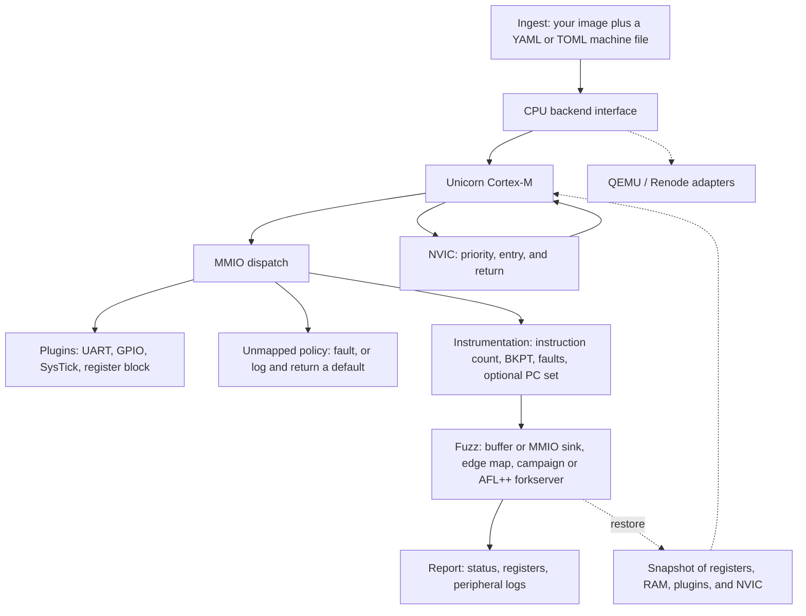

# Jig

Jig runs a firmware image you already have on a modeled microcontroller so you can trace it, snapshot it, and feed it fuzz input. The command is `jig-emu`. The Python package is `rehost`. The first CPU backend is [Unicorn](https://www.unicorn-engine.org/) emulating Cortex-M (Thumb and Thumb-2). Memory maps and peripherals come from a YAML or TOML file. QEMU and Renode can sit behind the same backend interface later; this tree does not implement them yet.

The tool does not download firmware. Tests and the built-in fixtures are synthetic programs assembled from source in this repository. Read [RESPONSIBLE_USE.md](RESPONSIBLE_USE.md) before you point it at a real image.

## Install

Python 3.11 or newer.

```bash
python3 -m pip install -e ".[dev]"
python3 -m pytest
jig-emu run --fixture uart-gpio
```

`pip install -e .` is enough to run the CLI. The `[dev]` extra adds pytest.

A successful fixture run looks like this:

```text
name: uart-gpio
status: halted
detail: bkpt
pc: 0x00000042
sp: 0x20004000
lr: 0xffffffff
instructions: 20
uart0 tx: 41
gpioa odr: 0x1
systick ctrl: 0x0 load: 0x0 val: 0x0
```

Exit status is `0` for a halt (`BKPT` or a configured halt address), `1` for a fault, `2` for a timeout, `3` for the instruction limit, and `4` for a bad config or a missing file.

## Layout

```text
src/rehost/
  backends/         CpuBackend and the Unicorn Cortex-M adapter
  peripherals/      plugin registry plus UART, GPIO, SysTick, register block
  fixtures/         Thumb assembler and the synthetic programs
  config.py         YAML/TOML machine loader
  machine.py        map, load, boot, run, snapshot
  fuzz.py           RAM-buffer and MMIO-script sinks, AFL++ input map
  coverage.py       AFL++ edge bitmap
  campaign.py       in-process coverage-guided campaign
  forkserver.py     AFL++ persistent-mode forkserver
  cli.py
examples/           copies of the fixture sources, for reading and editing
tests/
```

## Architecture



`Machine` is the object that ties these together. It asks the backend to map pages, execute, and read registers. It asks plugins what an MMIO load or store means. The Unicorn backend models the NVIC and exception entry in front of each instruction. Snapshots are plain data (register names, region bytes, plugin dicts, and the NVIC image), so a future backend can restore them without Unicorn context objects.

## Run your own image

```bash
jig-emu run --config examples/uart_gpio.yaml --firmware /path/to/image.bin
jig-emu run --fixture uart-gpio -v
jig-emu run --fixture fuzz-echo --input case.bin --snapshot-out after.json
jig-emu plugins
jig-emu fixtures
```

`--firmware` is a file you supply. `--config` is required with it, because the tool will not guess a memory map. `--fixture` selects one of the synthetic programs and, if you omit `--config`, its packaged machine file.

`--dump 0x20000000:16` prints a hex dump after the run. Repeat the flag for more windows.

## Machine file

`examples/uart_gpio.yaml` is a complete example. Addresses may be integers or `0x` strings. TOML works the same way (`jig-emu run -c machine.toml --firmware image.bin`).

```yaml
name: uart-gpio
arch: cortex-m          # registered backend; only cortex-m today
endian: little

load:
  base: 0x00000000      # where --firmware is copied

memory:
  - name: flash
    base: 0x00000000
    size: 0x1000
    perms: rx           # r, w, x in any combination
  - name: sram
    base: 0x20000000
    size: 0x4000
    perms: rw           # writable regions are included in snapshots
  - name: uart0
    base: 0x40000000
    size: 0x100
    perms: rw
    peripheral: uart    # plugin name
    config:
      data_offset: 0x00
      status_offset: 0x04
      tx_empty_mask: 0x80
  - name: spare
    base: 0x40020000
    size: 0x100
    perms: rw
    mmio: true          # no model yet: log and return read_default
    read_default: 0

boot:
  mode: vector          # or entry, which needs sp and entry
  vector_base: 0x00000000

run:
  timeout_ms: 1000      # 0 means no time limit
  max_instructions: 1000000
  halt_on_bkpt: true
  halt_addresses: []    # stop before executing these PCs
  trace_limit: 256
  collect_coverage: false

unmapped:
  action: fault         # or log
  read_default: 0
  log: true
```

Regions must not overlap. The backend maps whole pages; two regions may share a page, and the page's permissions are the union. At least one of `timeout_ms` and `max_instructions` must be non-zero so a run cannot hang. `endian: big` is rejected.

`boot.mode: vector` reads the initial stack pointer and reset vector from `vector_base`, and sets the Thumb bit. `boot.mode: entry` starts at `entry` with `sp`.

### Plugins

| Name | Behavior |
| --- | --- |
| `uart` | A write to `data_offset` appends the low byte to `tx`. A read pops one byte from `rx` or returns 0. `status_offset` reports `tx_empty_mask` and, when `rx` is non-empty, `rx_ready_mask`. Other offsets are logged. |
| `gpio` | `odr_offset` is a latch. `idr_offset` returns `idr`, or the latch when `loopback: true`. |
| `systick` | CTRL / LOAD / VAL / CALIB at the Cortex-M offsets `0x00`, `0x04`, `0x08`, `0x0C`. While ENABLE is set, each instruction steps the counter once (CLKSOURCE does not select a second clock). A step that sees 0 reloads from LOAD, sets COUNTFLAG, and if TICKINT is set pends exception 15. A direct read of VAL, used by the plugin unit tests, still returns the current count and then steps. `irq_pending` stays set after the first TICKINT edge; the NVIC pending bit is what delivery clears. |
| `register_block` | `registers` maps a 4-byte-aligned offset to `{reset, writable}`. Unlisted offsets log and return `read_default`. |
| `unimplemented` | Every access is logged once at INFO and reads return `read_default`. `mmio: true` selects this plugin when `peripheral` is omitted. |

Unknown config keys are errors, so a typo does not silently do nothing.

## Add a peripheral

Put this in a module you import before you build the machine. Importing the module runs the decorator.

```python
from rehost.peripherals import Peripheral, register

@register("led_bank")
class LedBank(Peripheral):
    config_keys = frozenset({"read_default"})

    def __init__(self, **kwargs):
        super().__init__(**kwargs)
        self.last = 0

    def read(self, offset: int, size: int) -> int:
        return self.last & ((1 << (8 * size)) - 1)

    def write(self, offset: int, size: int, value: int) -> None:
        self.last = value & 0xFF

    def snapshot_state(self) -> dict:
        return {"last": self.last}

    def restore_state(self, state: dict) -> None:
        self.last = int(state["last"])
```

```yaml
- name: leds
  base: 0x40010000
  size: 0x100
  perms: rw
  peripheral: led_bank
```

`read` and `write` see offsets from the region base. Sizes are 1, 2, or 4. `snapshot_state` must return JSON-friendly values (`int`, `str`, `bool`, `list`, `dict`) or `bytes` (stored as hex in the snapshot file). The machine calls it for every fuzz iteration that uses `PersistentHarness`.

`jig-emu plugins` lists whatever has been registered by the installed package. Your class appears after the process imports your module.

## Add a CPU backend

Subclass `CpuBackend`, implement the abstract methods, and register the `arch:` string. The methods `Machine` calls are `map_memory`, `protect_memory`, `read_memory`, `write_memory`, `read_register`, `write_register`, `read_registers`, `write_registers`, `start`, `stop`, the four hook installers, and `inject_irq`.

```python
from rehost.backends import CpuBackend, register_backend

@register_backend("qemu-cortex-m")
class QemuCortexM(CpuBackend):
    arch = "qemu-cortex-m"
    # map_memory, start, stop, hooks, ...
```

`arch: qemu-cortex-m`, `renode`, and `riscv` are recognized as planned names and fail with that explanation. They are not wired up.

`inject_irq(n)` pends external IRQ `n` (exception `16 + n`). On the Unicorn backend that bit enters the NVIC: the handler runs only when the IRQ is enabled, its group priority can preempt, and PRIMASK, FAULTMASK, and BASEPRI allow it. `backend.pending_irqs` is the list of external IRQs that are still pending.

## Snapshots

```python
from rehost import Machine

machine = Machine.from_fixture("uart-gpio")
machine.boot()
snap = machine.snapshot()
# mutate guest RAM or let a run complete, then:
machine.restore(snap)
snap.write_json("state.json")
```

The snapshot includes general-purpose registers, `sp`, `lr`, `pc`, `xpsr`, the Cortex-M banked stack and mask registers Unicorn exposes, every writable non-peripheral region, each plugin's `snapshot_state`, and the NVIC/SCB image (`cpu` in the JSON: enable, pending, active, priority, VTOR, priority grouping). Flash is not saved; reload the image, then restore. `Machine.restore` checks that the region set matches. A checkpoint taken for fuzzing therefore restores interrupt state with the RAM and the plugins.

## Fuzzing

`jig-emu fuzz` is a coverage-guided fuzzer. It calls `PersistentHarness.exec_one`, so every case starts from the same boot checkpoint (CPU, RAM, plugins, and NVIC). Two drivers share that hook, the edge map, and the crash rule:

* **In-process campaign**, used when you run `jig-emu fuzz` yourself. No AFL++ install is required. This is the driver to use for the planted-crash demo.
* **AFL++ persistent-mode forkserver**, used when `afl-fuzz` has attached the control pipes. The same process then stops between cases and lets afl-fuzz mutate.

libAFL is not a dependency. Its Python bindings (`pylibafl`) are a PyO3 extension over `libafl_sugar` and QEMU mode; they cannot host an existing Unicorn `Machine`, and they would add a Rust toolchain to this package. The campaign is the in-process shape (call the harness, observe a map, keep crashes) implemented in Python so one person can maintain it. The bitmap and the forkserver handshake follow AFL++.

### Run the planted crash

`fuzz-crash` is a synthetic Thumb program. It compares the first four bytes of the fuzz buffer with `JIG!`. Those bytes fetch an unmapped address and fault. Any other input executes `BKPT`. From a four-byte zero seed the deterministic stage matches one byte at a time, because each matched byte is a new edge, and that new input is extended before the rest of the parent input is finished.

```bash
jig-emu fuzz --fixture fuzz-crash --out ./fuzz-out --max-execs 3000 --stop-on-crash
```

A successful run prints `crashes: 1` and writes the bytes `JIG!` under `fuzz-out/crashes/`. The exit status of `jig-emu fuzz` is 0 when the campaign finishes; the crash count is in the summary and in that directory. `queue/` holds inputs that grew the edge map. `hangs/` holds guest timeouts and instruction-limit stops, which are not crashes.

```text
jig-emu fuzz --fixture fuzz-crash --out DIR [options]
jig-emu fuzz --config machine.yaml --firmware image.bin --out DIR --seeds DIR
```

| Flag | Meaning |
| --- | --- |
| `--out DIR` | Corpus, crashes, and hangs. Required for the in-process campaign. |
| `--seeds DIR` | Seed files, in sorted name order. The default seed is four zero bytes (or shorter, if the buffer is). |
| `--input FILE` | One extra seed. `-` reads stdin. |
| `--max-execs N` | Stop after N executions. Default 1000000. |
| `--stop-on-crash` | Return after the first crash. The input is still written to `--out`. |
| `--rng-seed N` | Havoc RNG. The summary prints the seed that was used. |
| `--persistent-iters N` | Under afl-fuzz, restart the child after N cases. Default 10000. |
| `--timeout-ms`, `--max-instructions` | Override the machine file for every case. |

The schedule is a deterministic walk of each byte on corpus items up to 16 bytes, then stacked havoc (bit flips, random and interesting bytes, arithmetic, insert, delete, splice, short overwrites). Fixed energy, one process. New coverage means an edge moved into a higher AFL hit-count class.

### What coverage is

Unicorn already calls a Python hook for every instruction. When a coverage map is attached, each *retired* instruction (not one skipped because an exception was taken instead) updates a 65536-byte hit-count map:

```text
cur   = ((pc >> 1) ^ (pc >> 17)) & 65535
index = cur ^ prev
prev  = cur >> 1
map[index] += 1          # saturated at 255
```

That is AFL's edge update. AFL QEMU mode hashes a translation-block address; this hashes the instruction address, because that is the hook Unicorn already provides, and because the instruction after a compare has to stay visible or a magic-byte ladder looks like one path. `run.collect_coverage: true` is a separate, optional set of PCs for the text report. The fuzzer does not need it.

`Machine.run` zeroes the map and `prev` at the start of every execution, then sets byte 0 to 1 (AFL's "this iteration ran" marker). The map is not stored in the snapshot. Restoring the boot checkpoint therefore cannot put the previous case's hits back, and it cannot leak them forward either. The campaign keeps its own classified maximum across cases.

### AFL++

The forkserver implements AFL++'s version-1 handshake (`0x41464c00 + 1`, map size, shared-memory fuzzing when the fuzz region is present) and the persistent loop: the child raises `SIGSTOP` between cases, and a crash is `SIGSEGV` so `waitpid` reports `WIFSIGNALED`. `FS_NEW_OPT_FUTEX` is not offered; current AFL++ still accepts this `SIGSTOP` path. A guest fault and a PC listed in `fuzz.crash_addresses` are both crashes. A timeout or an instruction limit is not: afl-fuzz has its own `-t` timeout, and a `BKPT` is a normal exit unless that PC is configured as a crash.

The forkserver process does not create a Unicorn engine. The child does, after `fork`, and checkpoints at boot before the first case.

```bash
mkdir -p seeds
printf '\0\0\0\0' > seeds/zero
AFL_PERSISTENT=1 afl-fuzz -i seeds -o afl-out -t 2000 -- \
  jig-emu fuzz --fixture fuzz-crash --out ./jig-out
```

`AFL_PERSISTENT=1` is read by afl-fuzz (the target file is a Python entry point, so afl-fuzz will not see the compiled-in `##SIG_AFL_PERSISTENT##` marker). Leave `AFL_MAP_SIZE` unset, or set it to at least 65536. Do not set `AFL_NO_FORKSRV`.

| Variable | Meaning |
| --- | --- |
| `__AFL_SHM_ID`, `__AFL_SHM_FD` | Coverage map. The fd is used when both are set. Only the first 65536 bytes are written. |
| `AFL_MAP_SIZE` | afl-fuzz's map. Must be at least 65536. |
| `__AFL_SHM_FUZZ_ID`, `__AFL_SHM_FUZZ_FD` | Testcase region: little-endian `u32` length, then the bytes. |
| `__AFL_SHM_FUZZ_MAP_SIZE` | Size of that region. Default 1 MiB + 4. |
| `AFL_FORKSRV_FD` | Optional. Control pipe fd; status is the next fd. afl-fuzz itself always uses 198 and does not set this. |
| `AFL_PERSISTENT` | Set in the environment of `afl-fuzz`, not required for the status word. |

Without the fuzz shared memory, pass `--input @@` and the child re-reads that file every iteration. With the fuzz region (what current afl-fuzz sets up), `--input` is not the per-case source.

Not in this fuzzer: CmpLog / RedQueen, IJON, the bug-pass map, dictionaries, parallel campaigns, and a corpus-minimization UI.

### Harness

You can still drive one case yourself. `fuzz.mode: buffer` zeroes `buffer.max_size` bytes at `buffer.address`, copies the testcase (truncated to `max_size`), and optionally stores the length as a little-endian `u32` at `length_address`.

`fuzz.mode: mmio` treats the testcase as a script of 12-byte records: `u32` address, `u32` value, `u8` size (1, 2, or 4), three padding bytes. Each record becomes a plugin write. The campaign trims a mutated script to a whole number of records.

`fuzz.crash_addresses` is a list of PCs. A halt there is a crash even though the status is `halted`. The low bit is ignored. A fault is always a crash.

```yaml
fuzz:
  mode: buffer
  buffer:
    address: 0x20000100
    max_size: 64
    length_address: 0x20000000
```

```python
from rehost import Machine, PersistentHarness

machine = Machine.from_fixture("fuzz-echo")
harness = PersistentHarness(machine)
for testcase in inputs:
    result = harness.exec_one(testcase)
    if result.faulted:
        result_path = "crash.json"
        machine.snapshot().write_json(result_path)
```

`exec_one` restores a checkpoint taken at boot, applies the testcase, and runs. Peripheral logs and RAM from the previous case are gone.

Input sources, in order:

1. `--input PATH`, or `--input -` for stdin
2. AFL++ shared memory when `__AFL_SHM_FUZZ_FD` or `__AFL_SHM_FUZZ_ID` is set. The map is the AFL++ layout: a little-endian `u32` length, then the testcase. `__AFL_SHM_FUZZ_MAP_SIZE` is the map size (default 1 MiB + 4).
3. `REHOST_INPUT_FILE`
4. stdin, when the machine file has a `fuzz:` section and stdin is not a terminal

`examples/fuzz_echo.s` loads the word at `0x20000100` and writes the low byte to the UART. `jig-emu run --fixture fuzz-echo --input case.bin` is the command to try.

## Fixtures

| Name | Program |
| --- | --- |
| `uart-gpio` | Posts `A` to the UART, writes 1 to the GPIO latch, reads SysTick VAL, stores `0x00c0ffee` at `0x20000000`, then `BKPT`. |
| `fuzz-echo` | Loads the fuzz buffer at `0x20000100` and posts the low byte to the UART. |
| `fuzz-crash` | `BKPT` unless the buffer starts with `JIG!`, which fetches unmapped memory and faults. |

Sources live in `src/rehost/fixtures/data/` and are copied under `examples/`. The assembler in `rehost.fixtures.assemble` encodes the few Thumb and Thumb-2 instructions these programs use, so CI does not need a cross toolchain. It is not a general assembler.

To study a real RTOS image, build it yourself (a Zephyr sample or a FreeRTOS demo you compile) and pass the raw binary with `--firmware` and a machine file you write for that part. Do not commit the image here.

## Design notes

- Unicorn treats an until-address of 0 as "stop at PC 0", which is the reset vector. The runner uses an until-address above 32 bits and stops from hooks instead.
- On Unicorn 2.1 the memory-read hook runs before the load retires. The dispatcher writes the plugin's value into guest memory inside that hook, and the instruction observes it.
- Unicorn's `uc_emu_start` timeout is microseconds. The machine file's `timeout_ms` is converted at the backend boundary. The Python binding's docstring that says milliseconds does not match Unicorn 2.1.
- A page is mapped writable so the image can be copied, then `run` applies the permissions from the config.
- While a `Machine` owns SysTick, the counter steps once per instruction fetched for execution while ENABLE is set. It is not a cycle-accurate clock. `CLKSOURCE` is stored and does not select a separate reference.

## Interrupts

The Unicorn backend delivers ARMv7-M exceptions before each instruction. SysTick is exception 15. External IRQ `n` is exception `16 + n`. The vector address is `VTOR + exception * 4`, and bit 0 of that word must be set. `boot.mode: vector` initializes VTOR from `vector_base`.

On entry the model stacks `r0`, `r1`, `r2`, `r3`, `r12`, `lr`, the return PC, and `xPSR` on MSP or PSP (PSP only from Thread mode with `CONTROL.SPSEL`). `CCR.STKALIGN` (set at reset) forces 8-byte alignment and records the adjustment in stacked `xPSR` bit 9. `lr` becomes `0xFFFFFFF1` (back to Handler mode on MSP), `0xFFFFFFF9` (Thread mode, MSP), or `0xFFFFFFFD` (Thread mode, PSP). The handler runs on MSP with IPSR set to the exception number. Return is recognized on `BX`/`BLX`, `MOV PC`, and 16-bit or Thumb-2 `POP`/`LDM` that load an `EXC_RETURN` value; the frame is unstacked and `FAULTMASK` is cleared except on the way out of NMI.

A pending exception runs when it is enabled, not already active, and its group priority is strictly more urgent than the execution priority. All eight priority bits are implemented. `AIRCR.PRIGROUP` splits group priority from subpriority. PRIMASK boosts execution priority to 0, FAULTMASK to -1, and BASEPRI masks on the group field (a zero group field disables BASEPRI). NMI is fixed at -2 and HardFault at -1. `inject_irq`, `ISPR`/`STIR`, and `ICSR` (`PENDSVSET`, `PENDSTSET`, `NMIPENDSET`) latch pending bits. Taking the exception clears the pending bit. `SVC` enters SVCall, or HardFault if the current priority or a mask blocks it.

`WFI` and `WFE` do not suspend the emulator. If an exception can be taken, the stacked return PC is the instruction after the hint. Otherwise the hint retires in one instruction, including when PRIMASK or BASEPRI is holding a pending interrupt off, so `timeout_ms` and `max_instructions` still stop a wait loop.

Not modeled: tail-chaining and late arrival (a new exception after a return is unstacked and stacked again), lazy floating-point frames (`EXC_RETURN` bit 4 clear stops the run), v8-M stack limits and security extensions, and `SLEEPONEXIT` / `SLEEPDEEP` (the bits are stored and do not change control). `AIRCR.SYSRESETREQ` stops the run as a fault instead of resetting the core.

## Roadmap

Done:

- Coverage-guided fuzzing. `jig-emu fuzz` runs an in-process campaign, and the same command speaks the AFL++ persistent-mode forkserver when afl-fuzz attaches. See [Fuzzing](#fuzzing).

Not in this version:

- CmpLog / RedQueen, parallel campaigns, and a corpus-minimization UI
- RTOS and BSP shims for VxWorks, QNX, and ThreadX, including HAL-call replacement
- A RISC-V backend
- QEMU and Renode adapters on `CpuBackend`
- Printer, ICS, and other device-specific peripheral models
- A new CPU emulator. Decode and execute stay in Unicorn, or in QEMU/Renode when those adapters exist.

## License

MIT. See [LICENSE](LICENSE) and [RESPONSIBLE_USE.md](RESPONSIBLE_USE.md).
